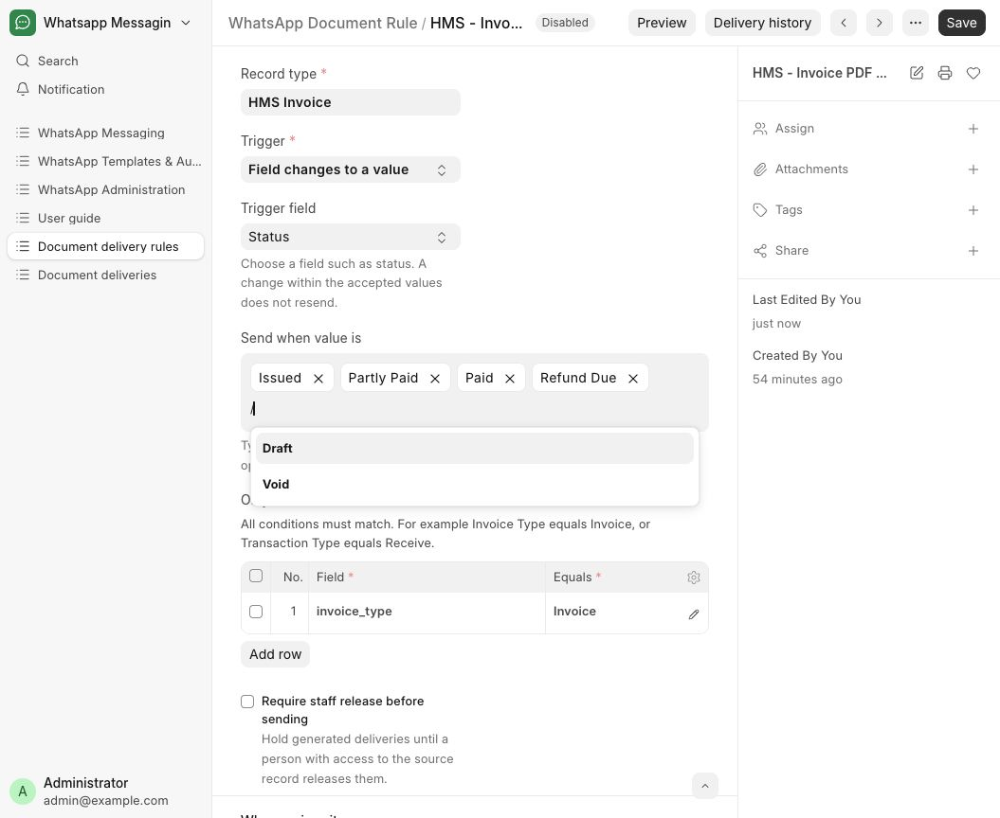
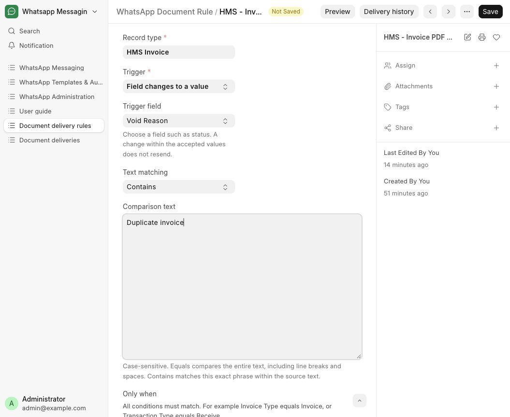
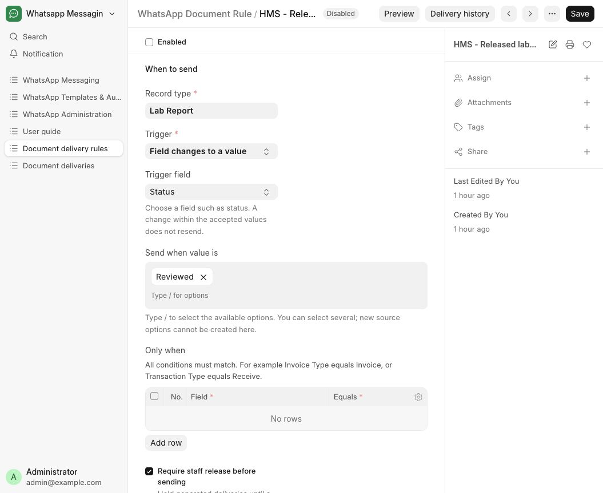
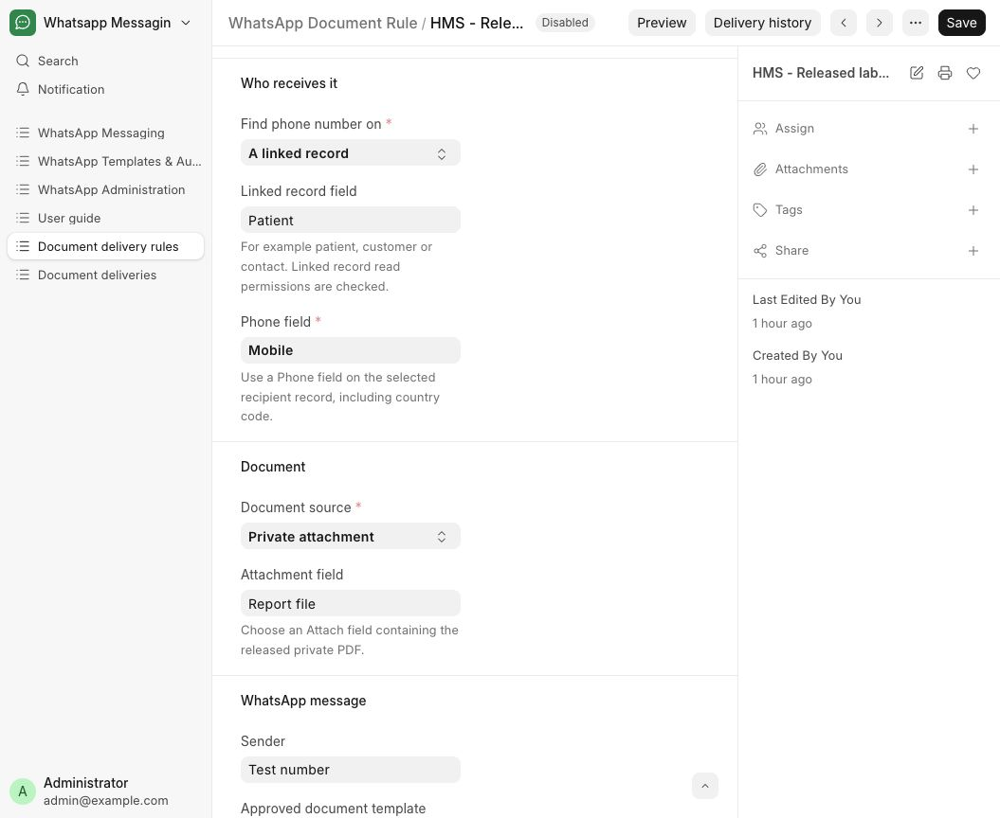

# Configure automatic WhatsApp document delivery

The configuration DocType is **WhatsApp Document Rule**. A rule defines which business record, event, recipient, PDF and approved WhatsApp wording belong together. Each matching event creates a **WhatsApp Document Delivery** entry. The actual message uses the existing **WhatsApp Outbox**, **WhatsApp Message** and **WhatsApp Inbox**.

Updated 30 October 2026.

Local development: [Document delivery rules](http://hms.localhost:8000/desk/whatsapp-messaging/whatsapp-document-rule). In-app guides: [Send documents automatically](http://hms.localhost:8000/desk/whatsapp-guide/document-delivery) and [Send a reviewed laboratory report](http://hms.localhost:8000/desk/whatsapp-guide/laboratory-reports). Both the rule and delivery form have **Help → User guide**.

## 1. Prepare the sender once

1. Sign in to the local development site as Administrator or a user with **System Manager** or **Whatsapp Admin**.
2. Search Desk for **WhatsApp Phone Number ID**. This is the sender-account DocType.
3. Open your configured sender. Check its phone-number ID, WABA ID and credential using the existing sender setup. Choose the correct hospital account; the local preset currently references the existing **Test number** account.
4. In **WhatsApp Settings**, the switches are **Enable Outbound Requests** and **Enable Automation**. Outbound requests must be on to synchronize approved templates. Enable automation only when your rules and recipients are ready.
5. For an automatic PDF outside an active reply window, first create a Utility template with a **Document** header in Meta's WhatsApp Manager and wait for approval. A text-only header does not accept a PDF.
6. An example body for invoice delivery is: `Hello {{1}}, your invoice dated {{2}} is attached. Thank you.` Use the hospital's verified identity in the approved wording/footer. Header type: Document. Language: the language actually approved by Meta.
7. Open the sender in HMS and choose **Sync approved templates**. Synchronization updates the approved catalogue used by document rules. If you also want the content in your message-template library, select it and use **Import selected**.
8. Open the patient's conversation in **WhatsApp Inbox**. In **Details → Messaging permissions**, record permission only if the patient has actually agreed, enter how it was obtained, and ensure the number is not blocked. The phone must include the country code, for example `+91 …`. An existing conversation does not itself establish messaging consent.

## 2. Open the rule DocType

1. Use Desk search to open **WhatsApp Document Rule**, or use the local link above.
2. Open the inactive preset **HMS - Invoice PDF after issue**, or choose **Add WhatsApp Document Rule** to create another rule.
3. Keep **Enabled** unchecked while you configure and preview it.

## 3. Configure the invoice trigger

| Form field | Select / enter |
|---|---|
| Rule name | `HMS - Invoice PDF after issue` |
| Record type | **HMS Invoice** |
| Trigger | **Field changes to a value** |
| Trigger field | **Status** (`status`) |
| Send when value is | Use the shared chip input: type `/`, then select `Issued`, `Partly Paid`, `Paid`, and `Refund Due` |
| Require staff release before sending | Leave unchecked for the reviewed invoice workflow |

In **Only when**, add **Invoice Type** (`invoice_type`) equals `Invoice`. This excludes credit notes.

The accepted values form one group. Moving from Draft into that group creates one delivery; moving from Issued to Partly Paid does not create another. Draft invoices, void invoices and records already issued before the rule was enabled are not backfilled. A rule uses the record's saved version, so changing the document before preparation or dispatch can hold delivery for review.

### Triggers for other field types

- **Select / dropdown:** use the shared chip input. Type `/` to open remaining source options, or `/Paid` to filter them, then select an option. Repeat to select several values. It accepts only defined source options.
- **Check:** use the same chip input to choose Checked or Unchecked.
- **Data:** use the same chip input. Type `/` to find existing values on records you can read; type after the slash to search, such as `/Ready`. Suggestions return up to 20 distinct existing values. You can also type a custom value without `/` and press Enter to add it. Repeat for additional values; remove a chip with its × button or Backspace in an empty input. For example, a Data field can match `Ready for collection` or `Courier requested`. Matches are exact and case-sensitive. Saving also commits a custom value still in the input. A slash search is never saved as a comparison value.
- **Text / Small Text / Long Text:** choose **Text matching → Equals** or **Contains**, then enter **Comparison text**. Equals compares the entire source text, preserving spaces and line breaks. Contains checks for that exact phrase anywhere in the source text. Both are case-sensitive. Empty or whitespace-only comparison text is rejected.
- **Int:** enter accepted numbers, one per line.

Custom chips and comparison text are stored only on the WhatsApp Document Rule. Saving a rule never changes the source record or its field options. Changing the selected trigger field clears the previous comparison so it can be configured for the new field.

For Text, delivery is created when the saved field changes from not matching into matching. Editing text that already matches, while keeping it a match, does not create another delivery. Additional **Only when** conditions must also match.



Already-selected values remain as removable chips; suggestions show the remaining options. `/Refund` narrows the source options to Refund Due. For Data fields, a new chip creates a rule comparison only; it does not add a record or change any source-field options. If a Data search finds no existing value, clear `/` and type the custom value directly.



## 4. Configure the recipient

| Form field | Select / enter |
|---|---|
| Find phone number on | **A linked record** |
| Linked record field | **Patient** (`patient`) |
| Phone field | **Mobile** (`patient_phone_number`) |

The service reads the linked patient and checks permissions. It does not send to the invoice payer name, an employee or a fixed test contact. The rule's execution user needs access to both the invoice and its patient. For another app, choose its Customer, Contact or other linked party and that party's Phone field. If the business record has its own Phone field, choose **This record** instead.

## 5. Configure the changing PDF

| Form field | Select / enter |
|---|---|
| Document source | **Generate PDF** |
| Print format | **HMS - Itemized invoice** |

The worker renders the selected format against the invoice that triggered this delivery. It saves the PDF privately, attaches it to that source record and supplies it to the approved WhatsApp Document header. You do not attach one fixed invoice to the reusable message template.

For a lab report already attached to a record, select **Private attachment** and choose the record's attachment field instead. That file must be a private PDF attached to that same source record.

## 6. Choose the approved message and variables

1. Select **Sender**.
2. Select **Approved document template**. The picker offers approved DOCUMENT-header templates in that sender's WABA.
3. For the example body above, configure **Message variables**:

| Variable | Value from | Field name |
|---|---|---|
| 1 | **Recipient** | **Name** (`patient_name`) |
| 2 | **Record** | **Invoice Date** (`invoice_date`) |

Each variable replaces the matching numbered token in the approved message. Use **Fixed text** for a value that is genuinely the same for every delivery. Do not put a single patient's name or invoice number in a fixed value. The number of rows and positions must match the approved template.

4. Save the rule. Saving content or a disabled rule does not send a message.

## 7. Preview without sending

1. Open the saved rule and click **Preview**.
2. Select a source invoice you can read.
3. Check **Recipient**, **Document**, **Message**, whether the trigger matches, and whether staff release is required.
4. The preview does not create a PDF, outbox entry or message. Inspect the selected print format on that invoice's normal Print screen to review the actual document layout.
5. Correct the phone, mapping, template or print format if needed, then save and preview again.

## 8. Enable and use the rule

1. Ensure the sender is enabled, the document template is approved and patient permission is recorded.
2. Enable the rule and save it. The app records the configuring user as **Execution user**; that user must retain messaging and source-record access.
3. Ensure **Enable Outbound Requests** and **Enable Automation** are on in WhatsApp Settings.
4. Create a new **HMS Invoice**, select the patient, review the date/currency/items, and save it as Draft.
5. Click **Issue Invoice**. This creates the delivery in the same database transaction. The worker starts after the transaction commits.
6. The private PDF is generated and passed into the WhatsApp outbox. No manual download, upload or chat attachment is required.
7. A default queue worker and the normal Frappe scheduler must be running. The scheduler recovers pending preparation jobs if an immediate queue request is missed.

## 9. Check delivery or fix a held document

1. Open the rule and click **Delivery history**, or search for **WhatsApp Document Delivery**.
2. Open the delivery for that source record. **Preparation status** describes document preparation. **Message status** and **View message delivery** show the actual WhatsApp message/outbox outcome.
3. **Queued** does not mean delivered. Accepted, delivered, read, failed, held and unknown outcomes remain distinct in the canonical messaging log.
4. For **Held**, read **Action needed**. Common causes are missing permission, blocked recipient, missing international phone number, changed source, paused rule, unavailable approval or disabled automation.
5. For a correctable preparation failure, fix the problem and choose **Retry preparation**. This action cannot resend a message that already has an outbox entry. Review uncertain/unknown sends in the outbox; they are not automatically retried as new messages.
6. If the source or rule changed and the old delivery cannot be retried, return to the enabled rule and use **Prepare current document**. Select the current record. This explicit action creates a delivery only if there is no delivery for that same source/rule version. It does not replay an uncertain message.
7. Disabling the rule or automation holds still-unsent messages at dispatch. It cannot recall a document already accepted or delivered by WhatsApp.

## 10. Configure a laboratory report

Open the preset **HMS - Released laboratory report**:

| Form field | Value |
|---|---|
| Record type | **Lab Report** |
| Trigger | **Field changes to a value** |
| Trigger field | **Status** (`status`) |
| Send when value is | Type `/Reviewed` and select **Reviewed** as a chip |
| Require staff release before sending | **Checked** |
| Find phone number on | **A linked record** |
| Linked record field | **Patient** (`patient`) |
| Phone field | **Mobile** (`patient_phone_number`) |
| Document source | **Private attachment** |
| Attachment field | **Report file** (`report_file`) |
| Sender | The configured hospital account |
| Approved document template | The approved report-notification template with DOCUMENT header |

Map its message variables, save, preview and enable. When a report becomes Reviewed, its delivery waits in **Awaiting release**. A supervisor with write access to that report opens the delivery and clicks **Release document** after checking it is the authorized, current private report. The worker then sends the PDF automatically. Reviewing a report alone is not treated as publication permission.

Before clinical review, attach the completed private PDF to the report's **Report file**, fill **Received On**, and save. HMS requires the received date and file for Received or Reviewed reports. Clinical staff review the report and save **Status = Reviewed**. An already-reviewed report's status, file and review details are protected by HMS; do not change them to force another send. Configure the rule before the review transition, or use **Prepare current document** deliberately for an existing eligible version.





For a different source workflow with an explicit release state, configure that actual state. Use **Generate PDF** only when the source and print format contain the actual completed results; the blank laboratory worksheet print format is not a substitute for an authorized result report.

## Other examples

| Document | Record type | Typical event | Document source |
|---|---|---|---|
| Receipt | **Payment Recipit** | Status changes to `Posted`; **Only when** Transaction Type equals `Receive` | Generate PDF with the Payment receipt format |
| Refund receipt | **Payment Recipit** | Status changes to `Posted`; **Only when** Transaction Type equals `Refund` | Generate PDF with the Refund receipt format |
| Discharge summary | **Discharge Summary** | Status changes to `Finalized` | Generate PDF; the local preset also requires release |
| Prescription | **Patient Visit** | Your actual clinician authorization/release step | Appropriate completed print format; require staff release where needed |
| Document in another Frappe app | That app's business DocType | Record created, field transition or document submitted | Matching print format or its private PDF attachment field |

The **Only when** table supports exact-match conditions, all of which must match. Use separate receipt and refund rules because Payment Recipit stores both transaction types. No scripting or arbitrary filter expression is needed for these cases.

## Local installation status

The reviewed pack contains **40 inactive WhatsApp content drafts**, **16 custom HMS Print Formats**, and **3 inactive document-rule presets**. Existing local patient, invoice, message and outbox counts are preserved. Meta approval and real recipient delivery are separate from creating the local records. No template was submitted to Meta and no patient message was sent by the installer.

## Local worker recovery

A default queue worker is required. This local installation also has a document-only recovery helper, so pending document jobs and paced sends can recover while the broader development scheduler is off. It does not enable rules or process unrelated campaigns. Normal deployments use the Frappe scheduler. To restart this local helper from the bench sites directory if needed:

```sh
../env/bin/python ../apps/whatsapp_messaging/scripts/run_local_document_dispatcher.py --site hms.localhost
```
