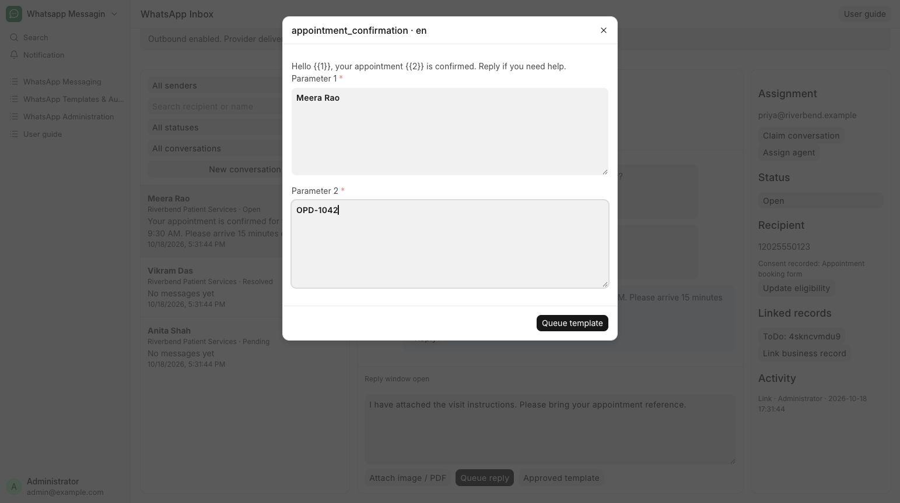

# Use an approved WhatsApp template

Confirm an appointment outside the reply window with an approved template.

**Who can do this:** Editor · Admin · System Manager

## What this workflow does

This lets you send a message using wording already approved by WhatsApp, including when the normal reply window is closed. You select the template and language, fill in its required values and queue the message. The app checks that the template belongs to the sender’s account and that the recipient is eligible to receive it.

[All workflows](README.md)

## 1. Check messaging permissions

An administrator must record the contact’s permission before you send a template. Blocked contacts cannot receive messages.

## 2. Choose Send a template

Choose Send a template, select appointment_confirmation and its language for Patient Services, then choose Review message. Only supported WhatsApp-approved templates for this business number are listed.

## 3. Fill in the message details

Review the wording and fill each Message detail field. Each replaces a numbered placeholder, such as {{1}}. In the hospital walkthrough, Message detail 1 is Meera Rao and Message detail 2 is OPD-1042. Check the name and appointment reference before sending.

## 4. Send the template

Choose Send template, then check the thread status. If the catalogue is empty, ask an Admin to sync approved templates from the sender form. Templates also provides the Meta review status and rejection guidance for authored content.

## What to check

The request uses the selected approved template and language with your supplied parameters.

## If you need help

Inbox sending uses supported approved templates with a text body and optional fixed text header and footer from the sender’s Meta account. To author or correct the wording, open Templates, choose Meta-approved template mode and manage its review there. Campaigns reference the reusable template for automated or bulk sending.

## Screenshots

Approved template parameter dialog: review the body and fill each numbered parameter.

## Related workflows

- [Record consent or stop sending](consent.md)
- [Create and review a message template](templates.md)
- [Configure a sender and integration](senders.md)
- [Send documents automatically](document-delivery.md)

Screenshots show local development screens. Available fields, values, sender accounts and actions depend on your site configuration and permissions. Updated 30 October 2026.
