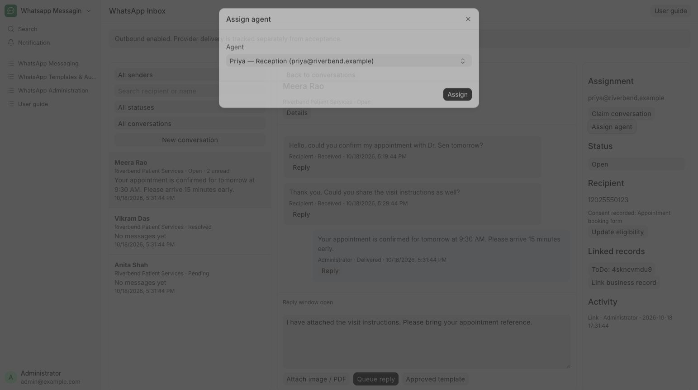

# Assign conversations and track progress

Coordinate patient conversations between reception staff.

**Who can do this:** Editor · Admin · System Manager

## What this workflow does

This records who will handle a conversation and whether it needs attention, is waiting for a response or is finished. Choose Assign to me to take responsibility, or Remove assignment to release your own conversation. Supervisors can assign conversations to another team member.

[All workflows](README.md)

## 1. Assign a conversation to yourself

Open a conversation, choose Contact details, then Assign to me. Choose Remove assignment when you no longer need to handle it.

## 2. Update your conversation’s status

In Contact details, use Status: Open for work that needs attention, Waiting when awaiting a response, and Resolved when finished. Editors must be assigned to the conversation to change its status.

## 3. Reassign when supervising

In Contact details, Admin and System Manager can choose Assign to someone, select a team member or Not assigned, and choose Save assignment.

## 4. Review activity

Expand Activity history in Contact details to review assignments, status changes and other actions. A new incoming message reopens a resolved conversation.

## What to check

The assigned team member and status update, with an entry in Conversation history. Use Assigned to me or Unassigned to find conversations.

## If you need help

Assignment coordinates work; app users still share permitted history and sending access. If another agent changed the thread first, refresh before trying again.

## Screenshots

Assign conversation dialog: a supervisor can choose a team member or Not assigned. In the current Inbox, open Contact details to find these controls.

## Related workflows

- [Find or start a conversation](conversations.md)
- [Link a business record](record-links.md)

Screenshots show local development screens. Available fields, values, sender accounts and actions depend on your site configuration and permissions. Updated 2026-11-01.
