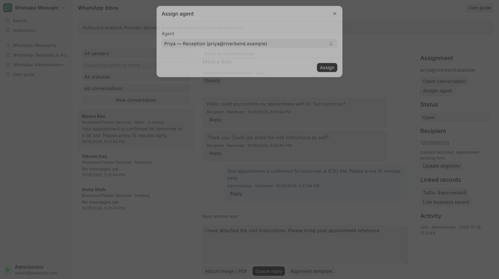

# Claim, assign and resolve

Coordinate patient conversations between reception staff.

**Who can do this:** Editor · Admin · System Manager

## What this workflow does

This records who is responsible for handling a conversation and what stage the work has reached. Users can claim or release conversations they are allowed to manage, while supervisors can assign them to another eligible user. Open, Pending and Resolved help the team track work that needs attention, is waiting or is finished.

[All workflows](README.md)

## 1. Claim an unassigned conversation

Open a thread and choose Claim conversation. Editors can claim unassigned conversations and release their own.

## 2. Update your conversation’s status

Use Change status: Open for active work, Pending when waiting, and Resolved when handled. Editors must own the thread to change its status.

## 3. Reassign when supervising

Admin and System Manager can choose Assign agent and select Priya from Reception, Anil the front desk lead, or Unassigned.

## 4. Review activity

The Activity section records assignment and status changes. A new incoming message reopens a resolved conversation.

## What to check

The owner and workflow status update, with an activity entry. Use Mine or Unassigned to find the next conversation.

## If you need help

Assignment coordinates work; app users still share permitted history and sending access. If another agent changed the thread first, refresh before trying again.

## Screenshots

Assign agent dialog: a supervisor can choose an eligible user or Unassigned.

## Related workflows

- [Find or start a conversation](conversations.md)
- [Link a business record](record-links.md)

Riverbend Hospital is a fictional training setting; no real patient data is shown. Updated 22 October 2026.
