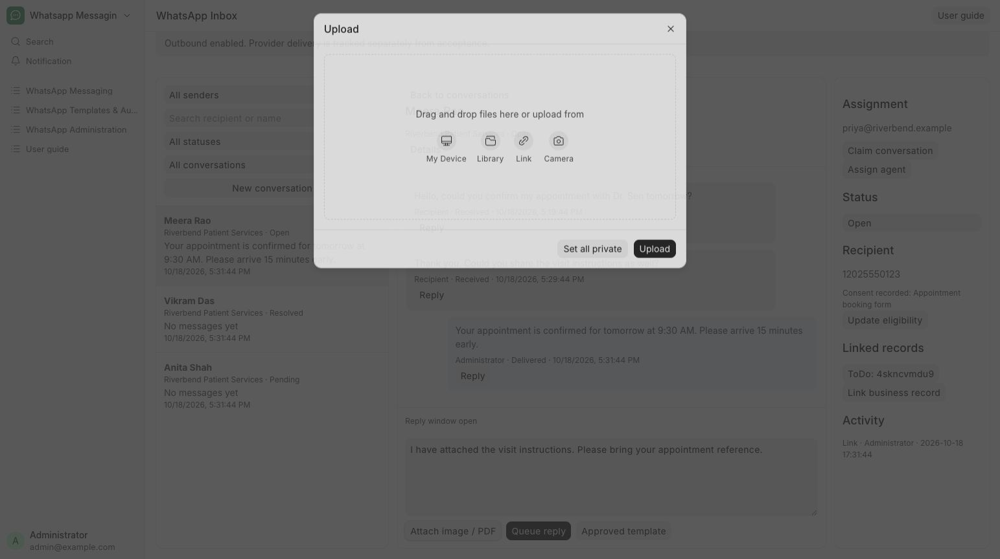

# Send an image or PDF

Share visit instructions as a private PDF or image.

**Who can do this:** Editor · Admin · System Manager

## What this workflow does

This lets you include a JPEG image, PNG image or PDF in a reply. The app checks the file’s type and size, stores it privately and includes it when you queue the message. The attachment stays connected to the message so permitted users can refer to it later.

[All workflows](README.md)

## 1. Check the reply window

Open the conversation and confirm Reply window open. Attachments use the normal reply path.

## 2. Choose a supported file

Choose Attach image / PDF and upload the visit-instructions PDF (up to 20 MB), or one JPEG or PNG (up to 5 MB). The app checks the actual file type as well as size.

## 3. Review the attachment

The selected filename appears in the composer. Add an optional caption. Choose Remove attachment if the wrong file was selected.

## 4. Queue and inspect

Choose Queue reply. Open a received attachment from the timeline only when its download is ready.

## What to check

The attachment is linked to the queued message and stored privately. Incoming unsupported files show a placeholder or blocked state.

## If you need help

Uploading a file alone does not send it. If a file is rejected, use one of the supported types; renaming a file extension does not change its actual type. WhatsApp Media uploads default to Private. Selecting an existing public library file is rejected; upload a private copy instead.

## Screenshots

Private file uploader opened from Attach image / PDF.

## Related workflows

- [Reply to a message](replies.md)
- [Check delivery and handle blocked sends](delivery.md)
- [Manage reusable media files](media-library.md)

Riverbend Hospital is a fictional training setting; no real patient data is shown. Updated 22 October 2026.
