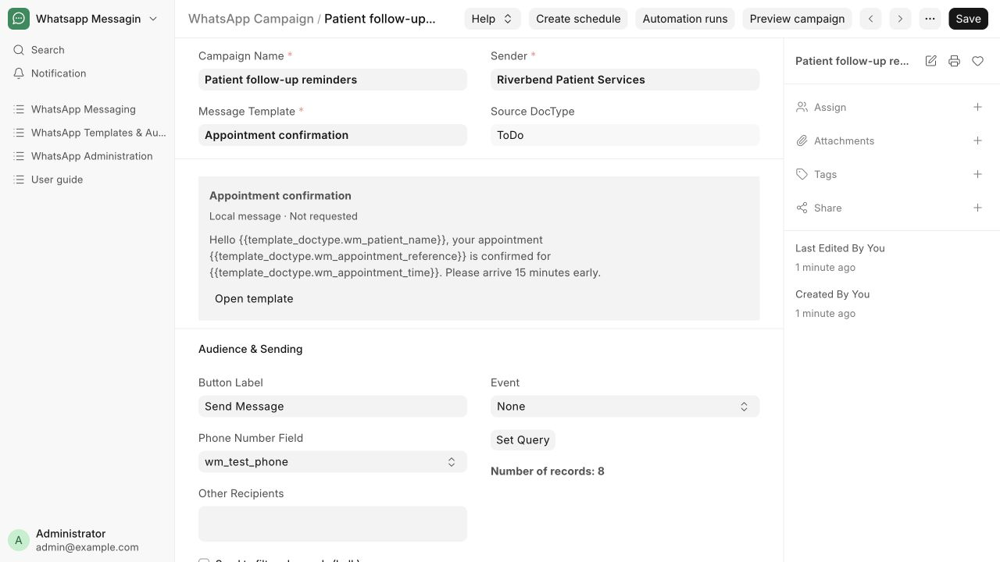
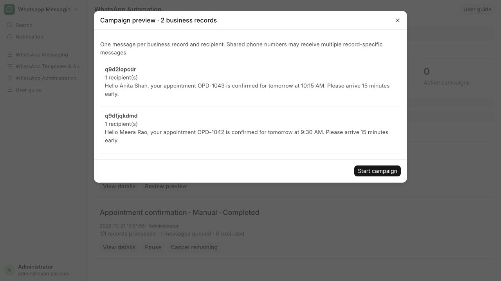

# Configure and run a campaign

Choose reusable content, recipients and the sending workflow.

**Who can do this:** Editor · Admin · System Manager; bulk start requires Admin or System Manager

## What this workflow does

This controls who receives a reusable message and when it should be prepared. A campaign selects a template, sender, recipient fields and record filters. It can support a manual action, a document event, a schedule or a reviewed bulk run. The message content and Meta approval stay on the selected template.

[All workflows](README.md)

## 1. Choose a reusable template

Open Templates & Automation → Campaigns or choose New campaign on Appointment confirmation. Give the campaign a recognizable name such as Tomorrow’s appointment reminders. Select Message Template and Sender. The source DocType is taken from the template; Open template lets you edit its content separately.

## 2. Select recipients and scope

Choose the patient phone field or reusable recipients. Use Set Query to select the appointment follow-ups to process. The fictional walkthrough uses OPD-1042 and OPD-1043. Keep Disabled checked while preparing the campaign.

## 3. Choose the sending workflow

Use Custom or None for an action on a business record; a document Event for automatic changes; or Scheduled/Cron for future runs. Enable Automation Active for events and schedules. For a bulk run, select Send to filtered records (bulk), save and clear Disabled when ready.

## 4. Remind patients before a date

Choose Event = Date Reminder and a Reminder Date Field. For Patient follow-ups choose Follow Up; for OP expiry choose Validity Expiring On. Set Start Reminders (Days Before) to 2, Daily Reminder Time to 09:00 and the timezone to Asia/Kolkata. This sends at 9 AM two days before, one day before and on the due date. Use additional filters to exclude disabled patients. Automation Active creates the daily schedule when the campaign is saved and enabled.

## 5. Preview a bulk run

An Admin opens Campaign Runs → Preview campaign and selects the saved campaign. Review every page of personalized messages, recipients and exclusions. Previewing does not send. Repeated family phone numbers receive a separate message per source record.

## 6. Start and monitor

Choose Start campaign after review. Check record processing separately from delivery status. Pause, Resume or Cancel remaining work from the run controls when needed.

## What to check

The run creates one message per business record and recipient, deduplicating repeated recipients only within that record.

## If you need help

Campaigns start Disabled. Enable only after reviewing the audience and content. Meta campaigns must use a sender from the same WABA as the template. Both campaign and shared template edits invalidate older previews and queued versions. Existing queued work may be held for review after the split; it is never automatically resent. Completed means record processing finished, not that every message was delivered. Global switches, consent, source permissions and sender eligibility still apply. Date reminders need the scheduler running. They recheck the date before sending and hold stale messages if the date changes. Use a Meta-approved template when recipients may be outside the reply window.

## Screenshots

Campaigns reference a template and separately configure sender, recipients, scope and workflow.

A bulk preview lists personalized messages before the explicit Start campaign action.

## Related workflows

- [Create and review a message template](templates.md)
- [Check delivery and handle blocked sends](delivery.md)
- [Record consent or stop sending](consent.md)

Riverbend Hospital is a fictional training setting; no real patient data is shown. Updated 24 October 2026.
