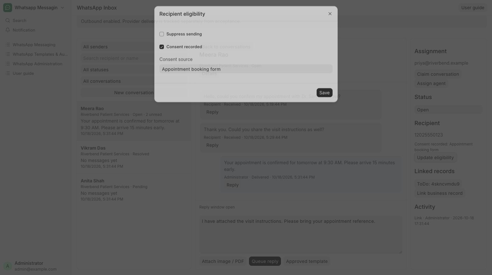

# Record consent or stop sending

Record appointment-message consent or stop sending to a patient.

**Who can do this:** Admin · System Manager

## What this workflow does

This records whether a contact has agreed to receive messages and how that permission was received. An administrator can block outgoing messages to a number, including replies and templates. These permissions are checked again before sending.

[All workflows](README.md)

## 1. Open the recipient’s thread

Confirm the contact’s WhatsApp number in Details before changing messaging permissions.

## 2. Choose Messaging permissions

Choose Messaging permissions. Select This contact has agreed to receive messages only when they have given permission. Under How was permission received?, enter its source, such as Appointment booking form.

## 3. Block messages when needed

Enable Block messages to this number to stop all outgoing messages to this contact. Choose Save permissions.

## 4. Review the result

Details shows the updated permissions, and Conversation history records the change. The app checks the permissions again before sending a waiting message.

## What to check

The contact’s permission or blocked state is saved. Blocking stops both replies and template messages.

## If you need help

Editors can view messaging permissions but cannot change them. Never record permission unless the contact has actually agreed to receive messages.

## Screenshots

Messaging permissions dialog shown to Admin and System Manager.

## Related workflows

- [Use an approved WhatsApp template](approved-templates.md)
- [Check delivery and handle blocked sends](delivery.md)

Riverbend Hospital is a fictional training setting; no real patient data is shown. Updated 24 October 2026.
