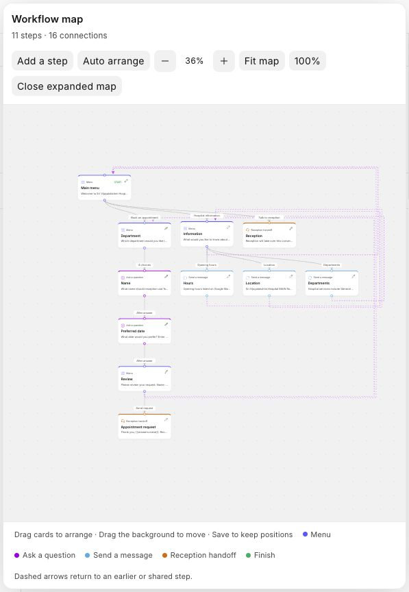
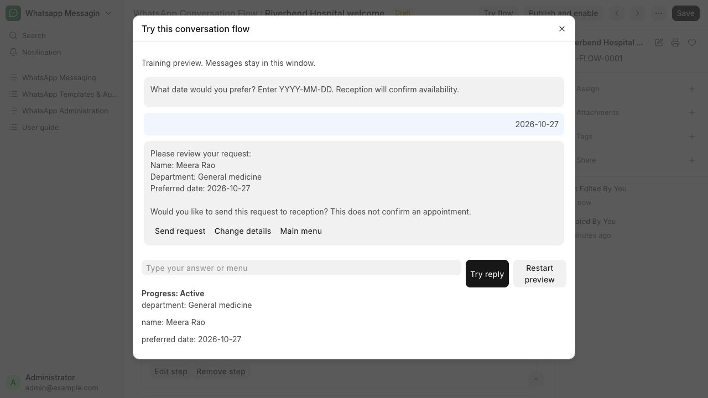
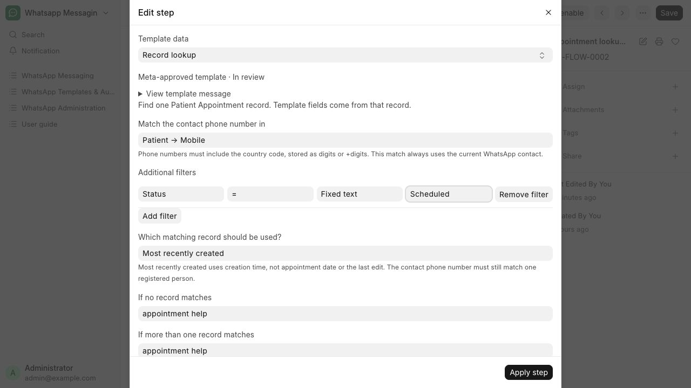
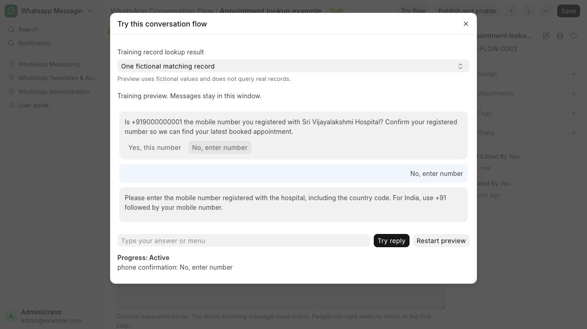
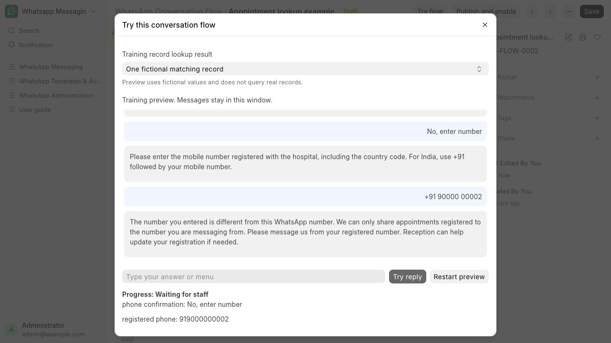

# Build a conversation flow

Guide people through menus, collect a request and hand over to reception.

**Who can do this:** Admin · System Manager; Editors can preview and handle conversations

## What this workflow does

A conversation flow replies when someone messages your business number. It can show menus, collect answers, send a saved template and pass the conversation to staff. A template step can find an existing record using the contact’s phone number and your filters. The hospital starter collects appointment requests for reception to confirm; it does not book appointments.

[All workflows](README.md)

## 1. Create a draft

Open WhatsApp Templates & Automation → Conversation Flows. Choose Create hospital starter flow, select your business WhatsApp number and choose Create draft. You can also create a flow from New.

## 2. Edit messages and choices

The Workflow map shows connected cards and a dot for each branch. Drag a dot onto another card to connect it, or click a branch to choose an existing step or add a connected step. Drag cards to arrange; Save keeps their positions. Use Undo/Redo to reverse edits. Choose a card’s pencil to edit its message or menu choices, then Apply step and Save. Menu labels must be unique and at most 24 characters. Fit map, Expand map, Auto arrange and Step list help you explore. Fill in hospital information before publishing.

## 3. Reuse a template and find its record

Add or edit a step, choose Template and select a saved text template. Flow values lets you choose an earlier answer, contact name, contact phone number or fixed text for each variable. Record lookup finds records of the template’s Source DocType using the contact’s WhatsApp number and your filters. For appointment confirmation, first show the current number and ask whether it is registered with the hospital. Yes continues; No asks for the registered number using a Phone question. An entered number matching the WhatsApp contact continues; a different number is not looked up. The bot asks the person to message from their registered WhatsApp number or contact reception for registration help. Appointment details are only shown for the current WhatsApp number. In the template step, select Patient → Mobile, Status equals Scheduled, and Most recently created. This uses booking creation time, not appointment date or last edit; no date question is needed. Choose reception for no booking or ambiguous registered contacts. Other flows can keep Require a single matching record. Phone numbers must include the country code.

## 4. Try the conversation

Choose Try flow. Select menu options or type in Preview reply. Test the booking, information and reception paths. For record lookup, choose one fictional matching record, no matching record or multiple matching records. The preview uses fictional values, does not query patient records and sends no WhatsApp messages.

## 5. Publish when ready

Choose Publish and enable to run the saved draft. Only one flow can be active for a business number. Enable Inbound, Outbound and Automation in WhatsApp Settings, and keep the background worker running. Changes saved afterward remain a draft until you publish again.

## 6. Handle a reception request

In the Inbox, open Details → Flow details to read the collected department, name and preferred date. Assign to me or send a manual reply to pause automatic replies. Confirm appointment availability yourself. Allow menu requests releases the conversation and waits for the contact to type menu; it does not send a message immediately.

## What to check

A new message starts the published menu when its start rule matches. Menu selections route to the correct step, saved answers are visible in Flow details, and handoff stops automatic replies. Old menu selections and repeated webhook events do not create another reply.

## If you need help

Meta templates must be approved before publishing a linked flow; local messages need an open reply window. Media templates are not supported in flow steps yet. Shared field approvals and the publishing user’s record permissions apply. If a template, record or approval changes before sending, the reply is held for review. The flow does not book appointments. Dates use YYYY-MM-DD and must be today or later; three unrecognised answers hand over to reception.

## Screenshots

Workflow map with connected hospital menu steps, branch labels and canvas controls.

Training preview with the hospital menu and appointment-request answers.

Template step with contact matching, appointment filters and reception fallback branches.

Choosing No asks for the registered hospital number before looking up an appointment.

A different entered number shows registration help; its appointments are not looked up.

## Related workflows

- [Reply to a message](replies.md)
- [Assign conversations and track progress](assignment.md)
- [Record consent or stop sending](consent.md)
- [Activate a campaign for document events](events.md)

Riverbend Hospital is a fictional training setting; no real patient data is shown. Updated 24 October 2026.
