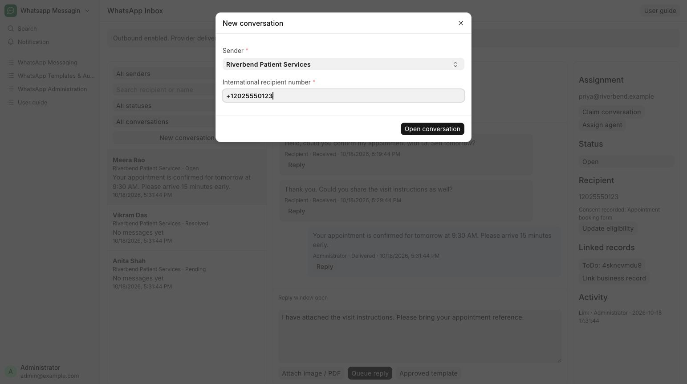

# Find or start a conversation

Find a patient conversation or start a thread from Patient Services.

**Who can do this:** Editor · Admin · System Manager

## What this workflow does

This groups messages between one recipient and one sender account into a conversation. You can search existing conversations, filter them by status, assignment or unread messages, and open a new conversation using a recipient’s phone number. Opening a conversation creates a place to exchange messages; it does not send anything by itself.

[All workflows](README.md)

## 1. Open Inbox

From Messaging, choose Inbox. Select Riverbend Patient Services or All business numbers, search for Meera Rao or another patient, and use the status and assignment filters.

## 2. Use your unread view

Choose Unread to see incoming messages you have not read. Reading a visible thread updates your own unread count, not another agent’s count.

## 3. Start a thread if needed

Choose New conversation, select Riverbend Patient Services and enter the patient’s international number with its country code. Choose Open conversation.

## 4. Review before composing

Confirm the sender and recipient in the thread. A new conversation does not send a message or establish a reply window.

## What to check

The selected thread opens. Older messages and additional conversations can be loaded with their respective Load more controls.

## If you need help

No senders available means a System Manager must configure an account first. Local read state does not send a WhatsApp read receipt.

## Screenshots

New conversation asks for a sender and an international recipient number.

## Related workflows

- [Reply to a message](replies.md)
- [Use an approved WhatsApp template](approved-templates.md)
- [Assign conversations and track progress](assignment.md)

Screenshots show local development screens. Available fields, values, sender accounts and actions depend on your site configuration and permissions. Updated 30 October 2026.
