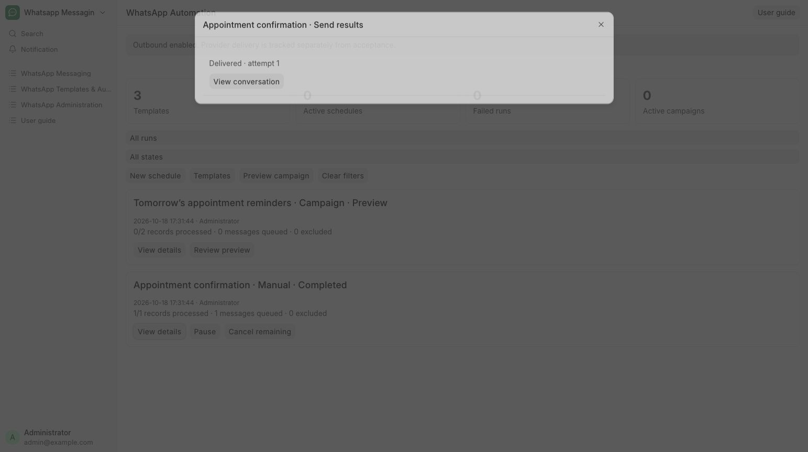

# Check delivery and handle blocked sends

Check whether patient messages were queued, blocked or delivered.

**Who can do this:** Editor · Admin · System Manager

## What this workflow does

This shows what happened to messages after they were queued, helping you find delays and failures. You can check whether a request is waiting, blocked, accepted by the provider or delivered, and review any available reason for a problem. The available controls let you cancel eligible unsent requests or retry confirmed unaccepted failures.

[All workflows](README.md)

## 1. Find the request

Use the conversation timeline or Campaign Runs → View details. Admin and System Manager can also open Administration → Outbound Queue and Send Attempts.

## 2. Read the status

In the Inbox, Waiting to send means the message is queued. Accepted by WhatsApp means WhatsApp has accepted it, but delivery has not been confirmed yet. Sent, Delivered and Read show later updates. Needs attention means sending is on hold; ask an administrator to check the reason.

## 3. Handle confirmed failures

Review the reason and fix the issue first. Retry confirmed failure is available only for a known unaccepted failure. Cancel send applies only to eligible requests before a network attempt starts.

## 4. Check an unconfirmed send before sending again

Send status not confirmed means the app does not know whether WhatsApp sent the message. Check its history and delivery updates before composing another message to avoid sending twice. The same uncertain request is not retried automatically. In administration screens, this status is called Unknown.

## What to check

You know whether work is queued, blocked, accepted or actually delivered. Run totals separate record expansion from send outcomes.

## If you need help

Editors can inspect their permitted run details; campaigns and administration diagnostics require Admin or System Manager. For delayed work, ask your System Manager to check switches, sender state, scheduler and workers.

## Screenshots

Automation run results show each request’s state and a link to its conversation.

## Related workflows

- [Reply to a message](replies.md)
- [Configure and run a campaign](campaigns.md)
- [Review inbound and webhook issues](webhooks.md)

Riverbend Hospital is a fictional training setting; no real patient data is shown. Updated 24 October 2026.
