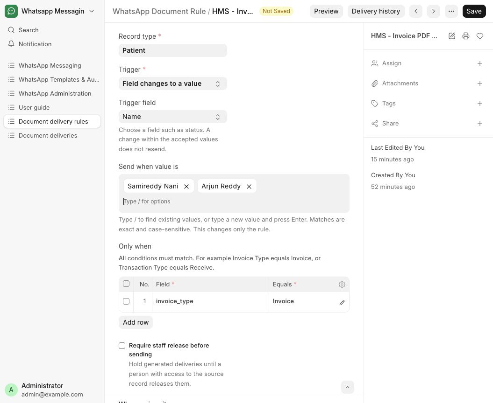

# Send documents automatically

Send generated invoice PDFs or private report attachments when a record matches your rule.

**Who can do this:** Admin · System Manager, with source-record access

## What this workflow does

WhatsApp Document Rule connects a business record, trigger, recipient, PDF and approved WhatsApp document template. Matching saved changes create a WhatsApp Document Delivery entry and use the normal outbox. Select and Data fields share a chip input; Text fields offer Equals or Contains. Comparison values belong only to the rule: they never change source records or field options.

[All workflows](README.md)

## 1. Prepare the sender and document template

A System Manager configures the sender and integration switches. Create a Utility template with a Document header in WhatsApp Manager, obtain approval, then open WhatsApp Phone Number ID and choose Sync approved templates. The local message editor does not author Document headers. Record recipient consent in Inbox → Details → Messaging permissions.

## 2. Open the rule DocType

Open Document delivery rules in the WhatsApp sidebar, or search for WhatsApp Document Rule. Create a rule or open HMS - Invoice PDF after issue. Keep Enabled unchecked while configuring. On rule and delivery forms, Help → User guide returns here.

## 3. Choose the source and event

Set Record type to the source business DocType, such as HMS Invoice. Choose Record created, Field changes to a value, or Document submitted. Submission is available only for submittable sources. For a field-change trigger, choose Trigger field from its dropdown.

## 4. Choose values for a dropdown or Check field

In Send when value is, type / to open defined source options, or type /Refund to filter them. Select an option to add its chip; repeat for several. For the invoice preset, keep Issued, Partly Paid, Paid and Refund Due. A Check field offers Checked and Unchecked. Remove a chip with × or Backspace in an empty input. This input does not create new source options.

## 5. Add custom Data values

Use the same chip input for a Data field. Type / to search up to 20 distinct existing values on records you can read; add text after / to narrow the results. To add a new comparison, type it without / and press Enter. For example, Ready for collection and Courier requested can be two accepted values. Matching is exact and case-sensitive. Saving commits a custom value still being typed; a slash search is never stored as a comparison.

## 6. Match Text, Small Text or Long Text

Choose Text matching → Equals or Contains, then fill Comparison text. Equals compares the entire text, preserving spaces and line breaks; Contains matches the exact phrase anywhere in the source text. Both are case-sensitive. Blank or whitespace-only comparisons are rejected. Changing Trigger field clears the old comparison. An Int field keeps one accepted number per line.

## 7. Add any extra conditions

Every Only when row must match. For invoices, add Invoice Type equals Invoice so credit notes do not use the invoice rule. The selected trigger values form one group: entering the matching group creates a delivery; changing within that group does not resend.

## 8. Choose the patient phone

Set Find phone number on to A linked record, Linked record field to Patient, and Phone field to Mobile. Use This record when the source itself holds the phone. Numbers need a country code. The execution user must retain access to the source and linked recipient.

## 9. Choose the document source

For invoices, choose Generate PDF and HMS - Itemized invoice. The worker renders the triggering record and saves its PDF privately. For a completed laboratory PDF, choose Private attachment and Report file. The attachment must be a private PDF belonging to that source record.

## 10. Map the approved message

Choose Sender and an Approved document template with a DOCUMENT header for that sender. Map every body variable from Record, Recipient or Fixed text. For Hello {{1}}, your invoice dated {{2}} is attached, map variable 1 to Recipient → Name and variable 2 to Record → Invoice Date.

## 11. Save and preview

Save the disabled rule and choose Preview. Select a source record and check recipient, document, message and whether the trigger matches. Preview creates no PDF, outbox entry or send. Use the source record’s normal Print screen to inspect the generated layout.

## 12. Enable the configured workflow

After checking approval, consent and mappings, enable the rule and save. The configuring user becomes Execution user. Enable Outbound Requests and Enable Automation in WhatsApp Settings, and run the worker and scheduler. Issue a new invoice or complete the configured source transition. Existing matching records are not backfilled automatically.

## 13. Release, monitor or resolve a held delivery

Open Delivery history or WhatsApp Document Delivery. If Require staff release before sending is checked, a supervisor with source write access must choose Release document. Preparation status and Message status are separate: Queued is not Delivered. Read Action needed for Held or Failed. Retry preparation only fixes preparation; inspect the outbox for a send already created. Unknown outcomes are not automatically resent. Prepare current document explicitly handles an eligible current source/rule version.

## What to check

The rule uses the right source field and comparison, recipient phone, private PDF and approved document template. Source records and source-field definitions stay unchanged. Check the actual WhatsApp delivery status rather than treating a queued or accepted request as delivered.

## If you need help

Only Whatsapp Admin and System Manager can configure these rules, and source/recipient permissions still apply. Data suggestions respect record query permissions; selected dropdown values come from the source field. Local presets remain disabled until configured with approved DOCUMENT-header templates. Meta approval and actual recipient delivery require separate verification.

## Screenshots

Invoice Status uses removable chips. Typing / opens the remaining defined options.

An unsaved rule edit demonstrates a Data field with an existing value and a newly typed custom value.

An unsaved rule edit demonstrates Contains and Comparison text for a Small Text field.

## Related workflows

- [Send a reviewed laboratory report](laboratory-reports.md)
- [Use an approved WhatsApp template](approved-templates.md)
- [Record consent or stop sending](consent.md)
- [Configure a sender and integration](senders.md)
- [Check delivery and handle blocked sends](delivery.md)

Screenshots show local development screens. Available fields, values, sender accounts and actions depend on your site configuration and permissions. Updated 30 October 2026.
