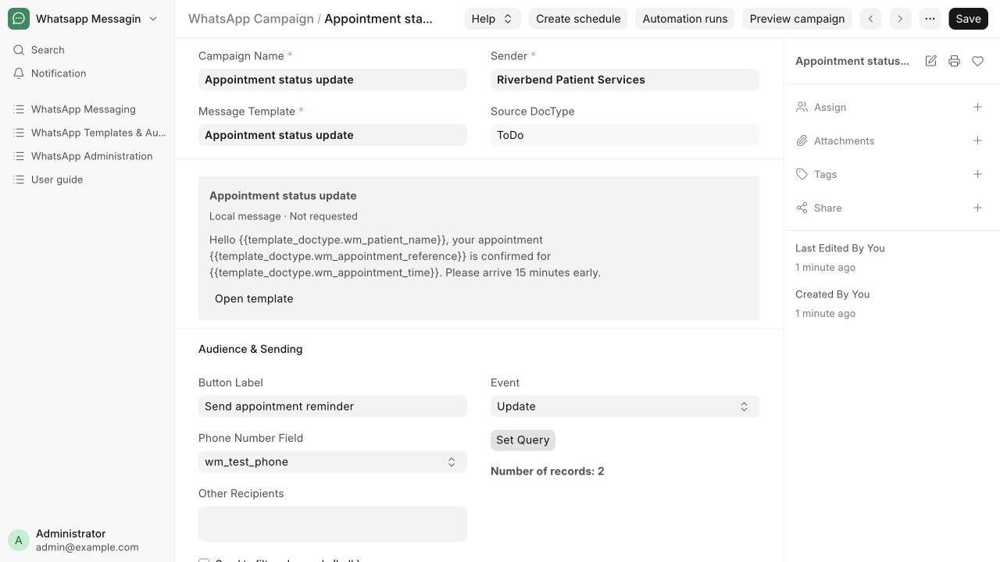
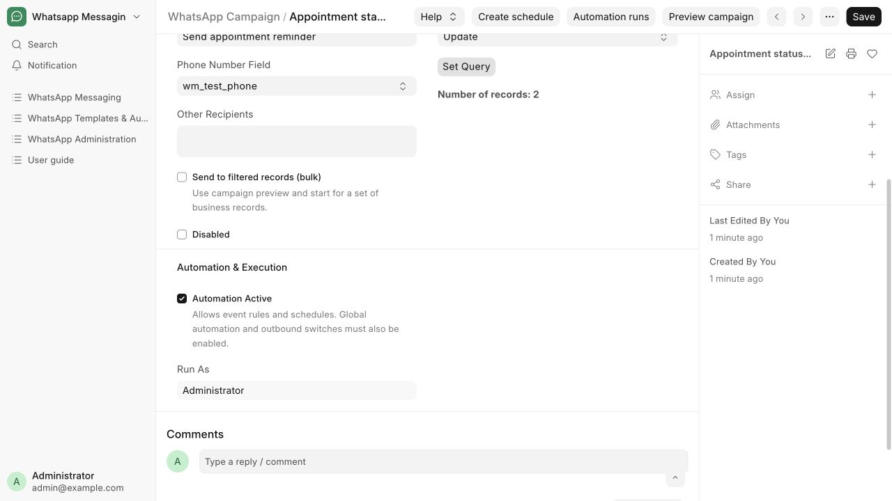

# Activate a campaign for document events

Queue a patient update when an appointment-related record changes.

**Who can do this:** Editor · Admin · System Manager

## What this workflow does

This automatically starts a message run when a business record undergoes a selected change, such as creation, update or submission. The app applies the saved campaign to that record and prepares messages for its recipients. The campaign must be active, and the user it runs as must still have the required access.

[All workflows](README.md)

## 1. Choose the event

Open the Appointment status update campaign and select the event matching your hospital process. The walkthrough uses Update on an appointment follow-up task. Use Update Field and Target Field for a specific field change.

## 2. Review recipients and content

Check the selected Message Template, sender, recipient field and source filters. Edit wording and approved fields from the template; change the audience here.

## 3. Activate and save

Clear Disable, enable Automation Active and save. Run As records the activating user. A System Manager must separately enable the required integration switches.

## 4. Inspect event runs

Perform the intended business action only when ready. Open Campaign Runs and filter Document events to inspect the resulting record and send outcomes.

## What to check

The matching business action creates a durable event run in the same transaction. A rolled-back source change cannot dispatch its message.

## If you need help

The activating user must keep the app role and source permissions. Disable the campaign or clear Automation Active to stop new event runs; already in-flight provider requests may finish. A date becoming due is not a record-update event. Use a Date Reminder campaign for follow-up and OP-validity reminders.

## Screenshots

An event campaign references shared content and selects the Update event.

Automation Active and Run As belong to the campaign.

## Related workflows

- [Create and review a message template](templates.md)
- [Check delivery and handle blocked sends](delivery.md)
- [Create or pause a schedule](schedules.md)
- [Send documents automatically](document-delivery.md)

Screenshots show local development screens. Available fields, values, sender accounts and actions depend on your site configuration and permissions. Updated 30 October 2026.
