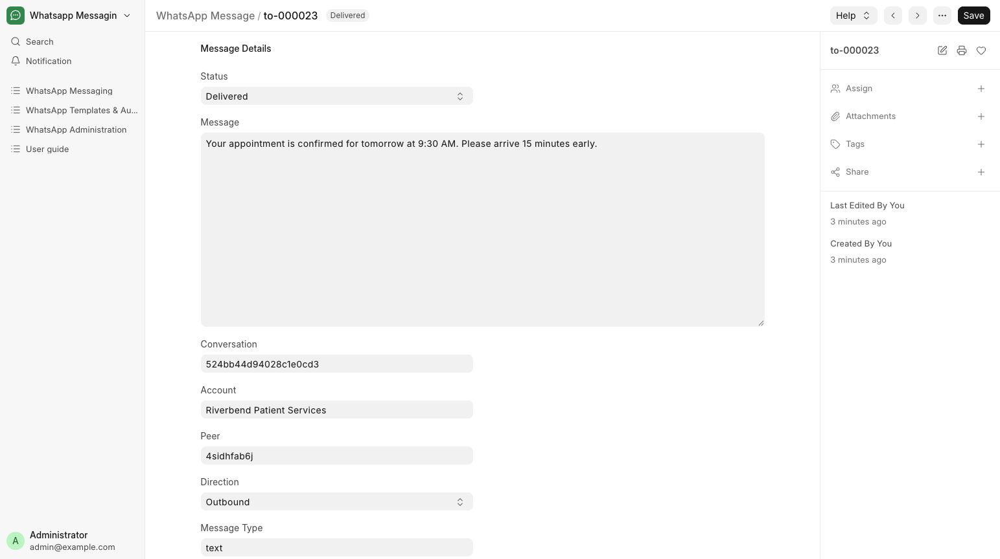

# Read messages and preserved history

Refer to patient conversations, individual messages and preserved history.

**Who can do this:** Editor · Admin · System Manager

## What this workflow does

Review incoming and outgoing messages, attachments and delivery statuses in the Inbox or directly on a conversation form. Message records provide individual details. Older records remain available for reference without sending them again.

[All workflows](README.md)

## 1. Use the inbox first

The inbox combines canonical incoming and outgoing messages for a specific sender and recipient. Open the thread to view its timeline.

## 2. Look up individual records

Messaging → Messages opens message records; Conversations opens conversation records. Use list filters to locate the relevant entry.

## 3. Read messages on the conversation form

Open Conversations and choose a record. Messages shows the latest 40 messages in order. Use Load older messages until all are shown, Refresh messages to check again, and attachment links to download files you can access. This form is read-only for live conversations. Use Open in Inbox to reply.

## 4. Recognize preserved legacy data

Older records remain available as history. They are not automatically assigned a guessed account or relabeled as delivered.

## 5. Use workflow actions for changes

Queue new messages from the inbox or configured record actions. Use assignment and status controls in the inbox instead of editing history records.

## What to check

You can refer to the stored history without changing the evidence of past sends. Canonical operational records are read-only through ordinary forms.

## If you need help

Historical messages are never automatically resent. If an old record has no reliable account or inbound window, use a correctly configured current conversation for new work.

## Screenshots

Canonical message record showing its status, content and account.

## Related workflows

- [Find or start a conversation](conversations.md)
- [Check delivery and handle blocked sends](delivery.md)

Screenshots show local development screens. Available fields, values, sender accounts and actions depend on your site configuration and permissions. Updated 2026-11-01.
