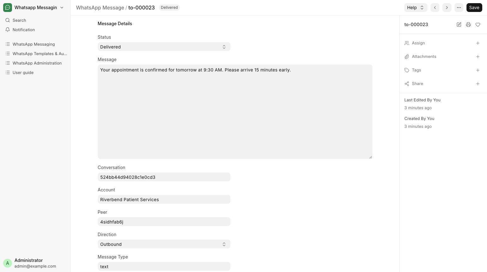

# Read messages and preserved history

Refer to patient conversations, individual messages and preserved history.

**Who can do this:** Editor · Admin · System Manager

## What this workflow does

This lets users review stored messages and conversations to understand what was sent or received and check recorded statuses. The inbox provides the conversation timeline, while message records provide individual details. Preserved older records remain available for reference without automatically sending them again.

[All workflows](README.md)

## 1. Use the inbox first

The inbox combines canonical incoming and outgoing messages for a specific sender and recipient. Open the thread to view its timeline.

## 2. Look up individual records

Messaging → Messages opens message records; Conversations opens conversation records. Use list filters to locate the relevant entry.

## 3. Recognize preserved legacy data

Older records remain available as history. They are not automatically assigned a guessed account or relabeled as delivered.

## 4. Use workflow actions for changes

Queue new messages from the inbox or configured record actions. Use assignment and status controls in the inbox instead of editing history records.

## What to check

You can refer to the stored history without changing the evidence of past sends. Canonical operational records are read-only through ordinary forms.

## If you need help

Historical messages are never automatically resent. If an old record has no reliable account or inbound window, use a correctly configured current conversation for new work.

## Screenshots

Canonical message record showing its status, content and account.

## Related workflows

- [Find or start a conversation](conversations.md)
- [Check delivery and handle blocked sends](delivery.md)

Riverbend Hospital is a fictional training setting; no real patient data is shown. Updated 24 October 2026.
