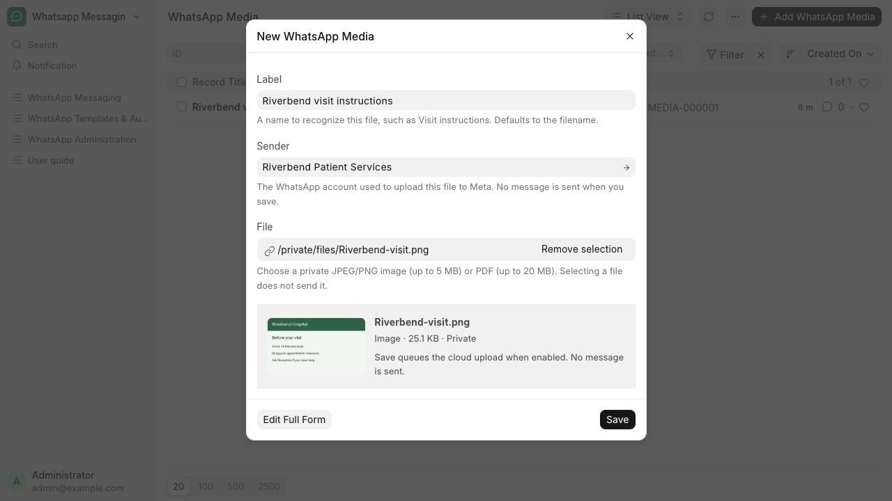
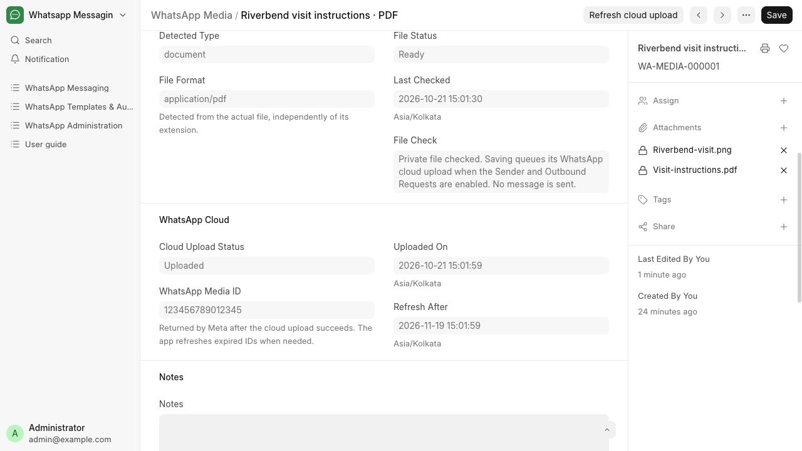

# Manage reusable media files

Keep visit-instruction images and PDFs ready for templates.

**Who can do this:** Editor · Admin · System Manager

## What this workflow does

This saves a private image or PDF for reuse in message templates and uploads it to WhatsApp Cloud for the selected Sender. The app checks the file, fills in its format and size, and shows the cloud upload status and Media ID. Saving media does not send a message to anyone.

[All workflows](README.md)

## 1. Add a reusable file

Open WhatsApp Messaging → Media and choose Add WhatsApp Media. Enter a recognizable Label, such as Riverbend visit instructions, or leave it blank to use the filename. Choose the Sender account, then a private JPEG/PNG image up to 5 MB, or PDF up to 20 MB.

## 2. Check and save

Review the private preview and detected size, then choose Save. The app fills in the file details and queues a background cloud upload after saving. Both Enable Outbound Requests in WhatsApp Settings and the selected Sender must be enabled. Uploading a file alone does not save the media entry, and saving media does not send a message.

## 3. Check the cloud result

Open the saved record. Pending or Uploading means the upload is waiting or running. Uploaded shows the WhatsApp Media ID and upload time. Blocked explains a setting or access problem; Failed explains an upload problem. Correct it and choose Upload / Retry. IDs are refreshed when needed; Refresh cloud upload lets you request a fresh ID.

## 4. Use the file in a template

Choose the saved Ready media under Content in a Message Template. Its Message Text becomes Caption. A message using the same Sender and file can reuse its current cloud Media ID. Another Sender, an expired ID or a file without a completed cloud upload uses a separate upload when that message is sent.

## 5. Replace or remove a selection

Open the media entry in the full form. Remove selection clears the choice without deleting the stored file. Choose a replacement and explicitly Save to apply it. File details update, the previous cloud ID is cleared, and a new upload is queued when enabled. Saving an existing entry with no file marks it Needs File and prevents its use in templates.

## 6. Review older records

Existing media is not uploaded automatically during the update. Choose its Sender and Save or Upload / Retry. Needs Attention means an old file could not be verified; choose a supported private replacement. Legacy URL records retain the URL for reference and require a private upload before use. The app does not fetch that URL or turn public files private.

## What to check

The saved file is Ready, shows the correct type and size, and appears in the template picker. With the Sender and Outbound Requests enabled and the media worker running, its Cloud Upload Status becomes Uploaded and a WhatsApp Media ID appears.

## If you need help

Notes are internal library notes, not outgoing captions. Removing a selection or deleting the library entry preserves stored files and existing message attachments; it does not delete an upload from Meta. File deletion is a separate action in File Manager. Changes affect future message preparation; queued messages retain their prepared file snapshots.

## Screenshots

Quick Entry asks for Label, Sender and File, then shows the detected type, size and private preview.

The saved form shows file details and the separate WhatsApp Cloud upload result.

## Related workflows

- [Create and review a message template](templates.md)
- [Send an image or PDF](attachments.md)
- [Check delivery and handle blocked sends](delivery.md)

Screenshots show local development screens. Available fields, values, sender accounts and actions depend on your site configuration and permissions. Updated 30 October 2026.
