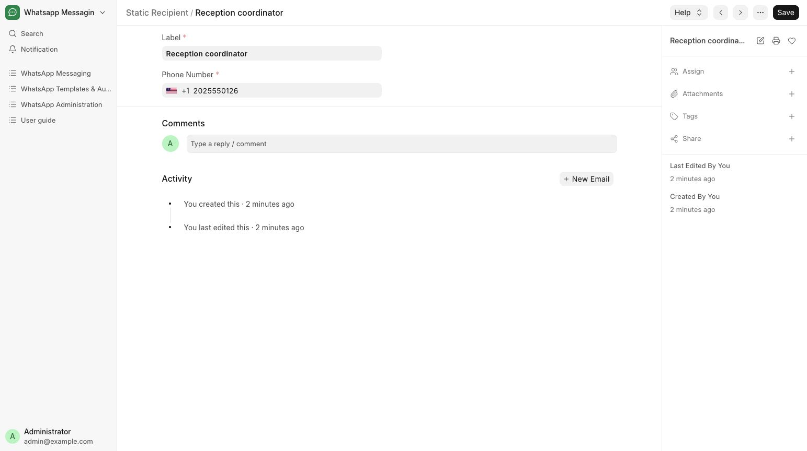

# Manage reusable recipients

Keep the reception coordinator’s contact available for local rules.

**Who can do this:** Admin · System Manager (Editors can select existing recipients)

## What this workflow does

This saves a named phone contact that can be reused in message rules. An Admin enters the name and number once, and users can select that contact under Other Recipients when configuring a rule. Saving a contact alone does not send a message or record consent.

[All workflows](README.md)

## 1. Open Recipients

From Messaging choose Recipients and add a Static Recipient named Reception coordinator.

## 2. Enter a recognizable label and phone

Enter Label. In Phone Number, select the country code and enter the national number. Save the recipient.

## 3. Select it on a template

Open the intended local template and select the entry in Other Recipients when the workflow requires an additional recipient.

## 4. Review before sending

Confirm the source recipient field and additional recipients together. A repeated number is deduplicated within each business record.

## What to check

The recipient can be reused on local rules. Saving a recipient does not create a conversation, record consent or send a message.

## If you need help

For a campaign, the same recipient can receive different messages for different source records. Consent and suppression rules still apply.

## Screenshots

Reception coordinator contact with the country code and phone number entered.

## Related workflows

- [Create and review a message template](templates.md)
- [Record consent or stop sending](consent.md)
- [Configure and run a campaign](campaigns.md)

Riverbend Hospital is a fictional training setting; no real patient data is shown. Updated 24 October 2026.
