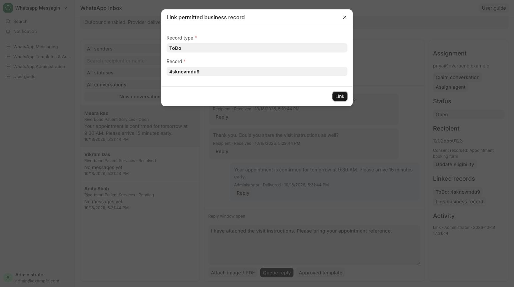

# Link a business record

Connect a patient conversation to the relevant appointment or follow-up record.

**Who can do this:** Editor · Admin · System Manager

## What this workflow does

This connects a conversation to a specific business record so users can move between the messages and the record they concern. The app checks that the user can read the record before creating the link. The link is saved with the conversation and recorded in its activity history.

[All workflows](README.md)

## 1. Open conversation details

On desktop use the right-hand details panel. On a phone open the thread and choose Details.

## 2. Choose Link business record

Choose Link business record, select the record type and the specific appointment or follow-up record, then choose Link. The walkthrough links Meera Rao’s OPD-1042 follow-up task.

## 3. Open the linked record

Use its button under Linked records to return to the business document.

## 4. Review activity

Check the activity entry to confirm which record was linked and by whom.

## What to check

The explicit link appears in the conversation. Sending from a readable source record also creates an explicit link.

## If you need help

Linking does not grant access to the business record. A matching phone number alone does not link records.

## Screenshots

Link permitted business record dialog with Record type and Record fields.

## Related workflows

- [Send from a business record](record-send.md)
- [Claim, assign and resolve](assignment.md)

Riverbend Hospital is a fictional training setting; no real patient data is shown. Updated 22 October 2026.
