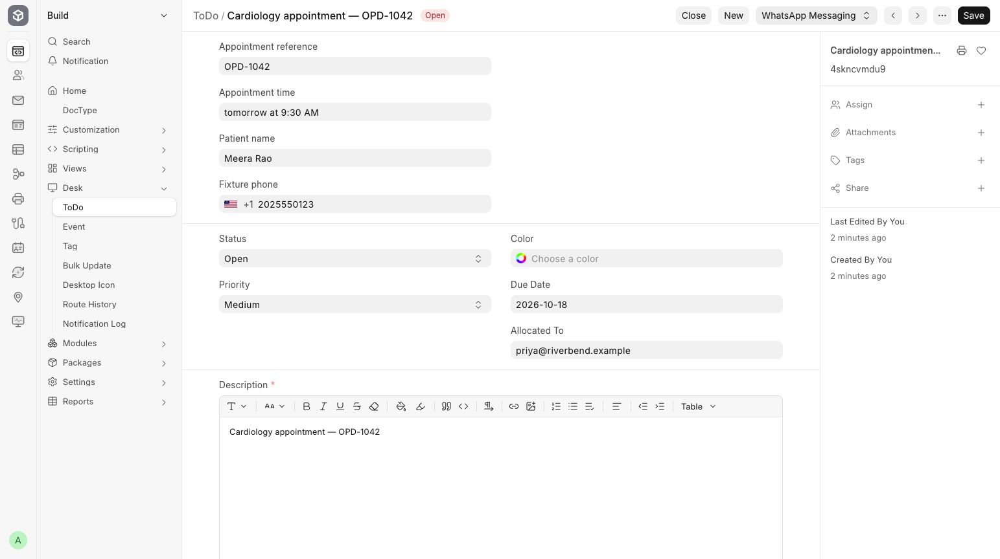

# Send from a business record

Send an appointment reminder from the related business record.

**Who can do this:** Editor · Admin · System Manager

## What this workflow does

This sends a message from a business record using a configured campaign. The app reads the recipient and approved message details from that record, creates a sending request and links the conversation back to the source. This reduces repeated typing and makes it clear which record the message concerns.

[All workflows](README.md)

## 1. Check the campaign

Configure an enabled campaign for the business DocType, reusable Message Template, sender and recipient field. Select None or Custom for a manual action. Bulk campaigns use preview and start instead.

## 2. Open the business record

Open a readable appointment or follow-up record. In this walkthrough, the appointment follow-up is a ToDo task. Open WhatsApp Messaging and choose Send appointment reminder, the Button Label configured on the campaign.

## 3. Run the configured action

Select the intended template action and review any prompt shown. The app creates a durable request rather than sending directly from the browser.

## 4. Open View Conversation

Use View Conversation when an explicit conversation link exists. Check the timeline and delivery state there.

## What to check

A single source-scoped request is queued and the conversation is explicitly linked to its readable source record.

## If you need help

If the action is missing, ask an Admin to check the campaign’s DocType, event, recipient mapping and disabled flag. Source permission and sender eligibility are checked again before dispatch.

## Screenshots

A fictional ToDo record with its configured WhatsApp message action.

## Related workflows

- [Create and review a message template](templates.md)
- [Link a business record](record-links.md)
- [Check delivery and handle blocked sends](delivery.md)

Riverbend Hospital is a fictional training setting; no real patient data is shown. Updated 24 October 2026.
