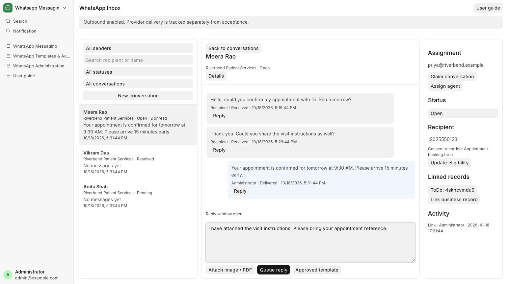

# Reply to a message

Reply to a patient and follow the message’s delivery status.

**Who can do this:** Editor · Admin · System Manager

## What this workflow does

This lets you write a text response in an existing conversation. The app saves the message, adds it to the sending queue and shows its progress in the conversation. Normal replies are available while the reply window is open and sending is allowed.

[All workflows](README.md)

## 1. Open the right thread

Confirm the sender, recipient and Reply window open notice. For a reply to a specific incoming message, choose that message’s Reply action.

## 2. Write your reply

Write the appointment confirmation or patient-services reply in Message text. In the walkthrough, reception confirms Meera Rao’s 9:30 AM appointment. Your draft stays while switching conversations within this page session; text is limited to 4,096 characters.

## 3. Queue the reply

Choose Queue reply once. This creates a send request; provider acceptance and delivery are separate outcomes.

## 4. Check the timeline

Look for the new message and its status. If the reply window has closed, choose Approved template instead.

## What to check

The message appears in the timeline with a status. Delivered or Read requires a corresponding provider receipt.

## If you need help

Queue reply is unavailable when outbound is disabled, the reply window is closed or the recipient is suppressed. Reloading the browser ends the in-memory draft session.

## Screenshots

Reply composer with Attach image / PDF, Queue reply and Approved template actions.

Desktop inbox with conversation list, timeline and recipient details.

## Related workflows

- [Send an image or PDF](attachments.md)
- [Use an approved WhatsApp template](approved-templates.md)
- [Check delivery and handle blocked sends](delivery.md)

Riverbend Hospital is a fictional training setting; no real patient data is shown. Updated 22 October 2026.
