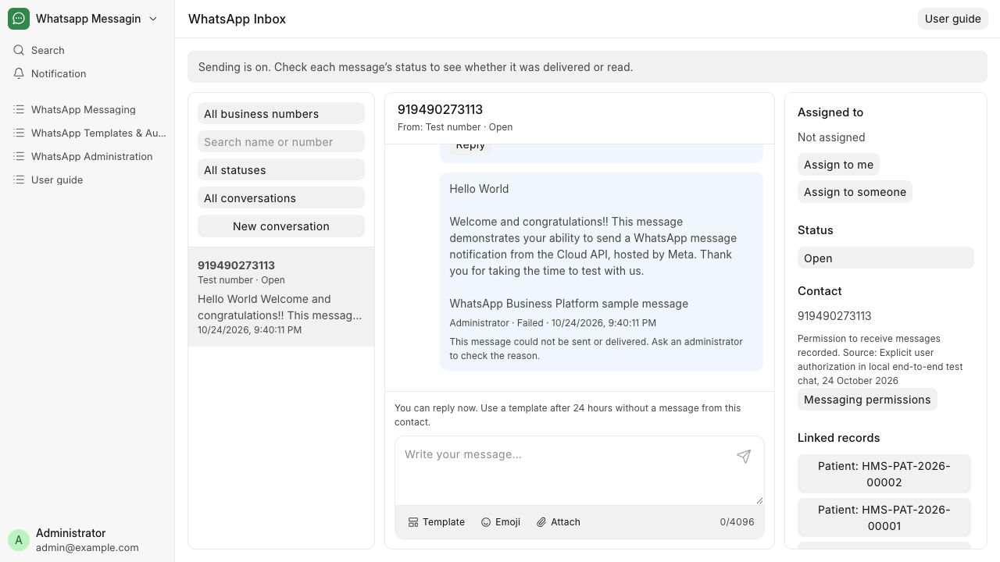

# Reply to a message

Reply to a patient and follow the message’s delivery status.

**Who can do this:** Editor · Admin · System Manager

## What this workflow does

This lets you write a text response in an existing conversation. The app saves the message, adds it to the sending queue and shows its progress in the conversation. Normal replies are available while the reply window is open and sending is allowed.

[All workflows](README.md)

## 1. Open the right thread

Confirm the sender, recipient and You can reply now notice. For a reply to a specific incoming message, choose that message’s Reply action.

## 2. Write your reply

Write in the message box. Add an emoji with Emoji, or attach an image or PDF with Attach. The counter shows 4,096 characters for text or 1,024 for an attachment caption. Your draft stays while switching conversations within this page session.

## 3. Send the reply

Choose the send arrow at the top right of the message box once, or press Ctrl+Enter (Command+Enter on Mac). The message first shows Waiting to send; check Delivered or Read for its later progress.

## 4. Check the timeline

Look for the new message and its status. If the reply window has closed, choose Template in the bottom toolbar.

## What to check

The message appears in the timeline with a status. Delivered or Read requires a corresponding provider receipt.

## If you need help

Send reply is unavailable when sending is off, the contact has been blocked or more than 24 hours have passed since their last message. The explanation above the reply box tells you what to do. Your draft stays when switching conversations in this tab, but reloading or leaving the page clears it.

## Screenshots

Message box with send arrow, Template, Emoji, Attach and a character counter.

Desktop inbox with conversation list, timeline and recipient details.

## Related workflows

- [Send an image or PDF](attachments.md)
- [Use an approved WhatsApp template](approved-templates.md)
- [Check delivery and handle blocked sends](delivery.md)

Screenshots show local development screens. Available fields, values, sender accounts and actions depend on your site configuration and permissions. Updated 30 October 2026.
