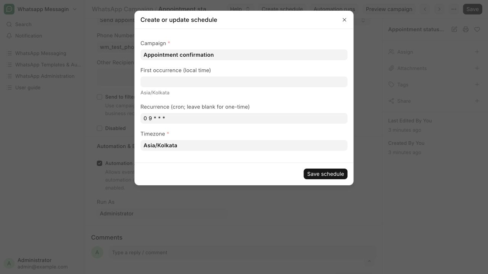

# Create or pause a schedule

Run daily appointment reminders or schedule a one-time follow-up.

**Who can do this:** Editor · Admin · System Manager

## What this workflow does

This runs a saved campaign at a chosen future time or on a repeating schedule. The app uses the selected timezone to work out when each run is due, then prepares messages for the records selected by the campaign. You can pause a schedule to stop it from starting further work and resume it when needed.

[All workflows](README.md)

## 1. Open New schedule

Open Templates & Automation → Campaign Runs and choose New schedule, or choose Create schedule on a saved campaign.

## 2. Choose the campaign and time

Select the Appointment confirmation campaign. For a one-time follow-up enter First occurrence (local time) and leave Recurrence blank. For daily 09:00 reminders use 0 9 * * * in Recurrence.

## 3. Confirm the timezone

Use an explicit timezone such as Asia/Kolkata. Save schedule. Check the resulting Schedule record’s state, Run As and Next Due At.

## 4. Pause or resume

Open the Schedule record and use Pause or Resume. Editors control their own schedules; Admin and System Manager can supervise others. Review each resulting run in Campaign Runs. To stop a recurring campaign, pause it and review existing queued work.

## What to check

The durable Schedule record controls future occurrences. Saving a schedule does not override disabled outbound or automation switches.

## If you need help

Missed occurrences within one hour may catch up once; older occurrences are skipped. Ambiguous or invalid daylight-saving local times are rejected. Pausing cannot recall a provider request already in flight.

## Screenshots

Create or update schedule: campaign, local occurrence, recurrence and timezone.

## Related workflows

- [Create and review a message template](templates.md)
- [Activate a campaign for document events](events.md)
- [Check delivery and handle blocked sends](delivery.md)

Riverbend Hospital is a fictional training setting; no real patient data is shown. Updated 22 October 2026.
