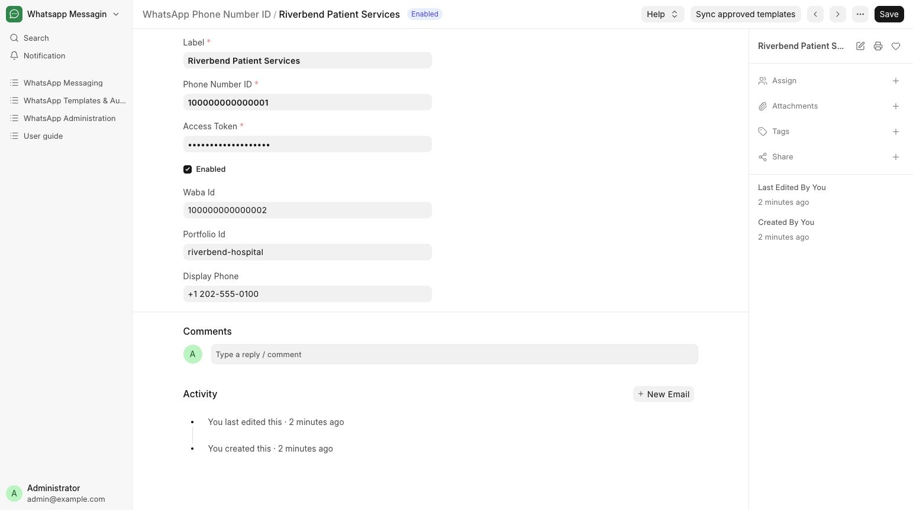
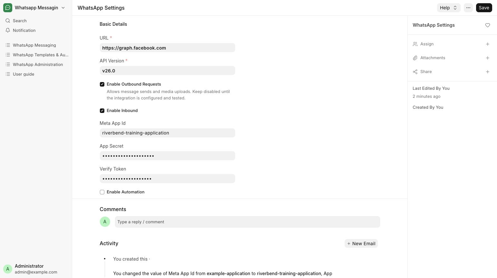
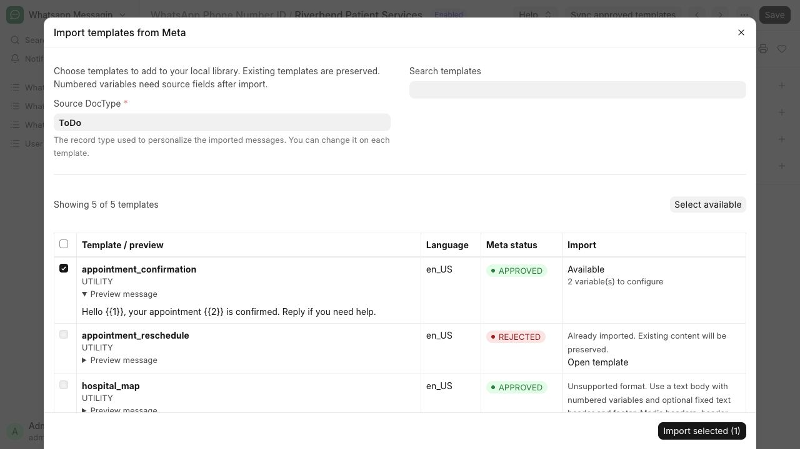

# Configure a sender and integration

Configure the hospital’s Patient Services sender and integration switches.

**Who can do this:** System Manager

## What this workflow does

This connects a WhatsApp business phone number to the app and gives it a recognizable account name. A System Manager enters its account details and credentials and controls whether sending, receiving and automation are enabled. Message rules and conversations then use that configured account as their sender.

[All workflows](README.md)

## 1. Open sender accounts

Open Administration → Phone Numbers and add a WhatsApp Phone Number ID. Quick Entry shows Label, Phone Number ID, Access Token and Enabled. Set Label to Riverbend Patient Services and enter the hospital’s correct external Phone Number ID. Leave Enabled off while preparing the account.

## 2. Enter account credentials

A System Manager enters Access Token. Choose Edit Full Form to add WABA ID and optional account details. Portfolio Id is the optional Meta business portfolio identifier used to group contacts across sender accounts; when blank, contact grouping falls back to WABA ID or the individual sender. Credentials remain restricted to System Manager.

## 3. Review integration settings

Open WhatsApp Settings. Review API configuration and, for inbound delivery, the application secret and verification token. Enable Outbound Requests, Enable Inbound and Enable Automation are separate switches and default off.

## 4. Enable only when ready

Confirm the account and integration configuration before enabling the required switches and sender. A worker and scheduler must be running for queued and scheduled work. An Admin can then use Sync approved templates on the sender form.

## 5. Select templates to import

On the saved Riverbend Patient Services sender, choose Sync approved templates. The dialog lists all Meta templates with language, review status and a message preview. Choose a Source DocType, select the supported entries you need and choose Import selected. Already-imported records are linked and preserved. Unsupported formats show why they cannot be imported.

## What to check

Sync refreshes the Meta catalogue for the WABA. Import selected adds only your chosen supported templates to the local library, without creating campaigns or sending messages.

## If you need help

Screenshots show fictional test configuration. They are not working credentials. Enabling outbound permits real provider requests on a configured live site; this guide does not enable anything for you.

## Screenshots

Riverbend Patient Services sender account with masked training credentials.

WhatsApp Settings: independent outbound, inbound and automation switches; secrets remain masked.

Import dialog: select reusable content from the Meta catalogue; existing and unsupported entries remain visible.

## Related workflows

- [Use an approved WhatsApp template](approved-templates.md)
- [Review inbound and webhook issues](webhooks.md)
- [Check delivery and handle blocked sends](delivery.md)

Screenshots show local development screens. Available fields, values, sender accounts and actions depend on your site configuration and permissions. Updated 30 October 2026.
