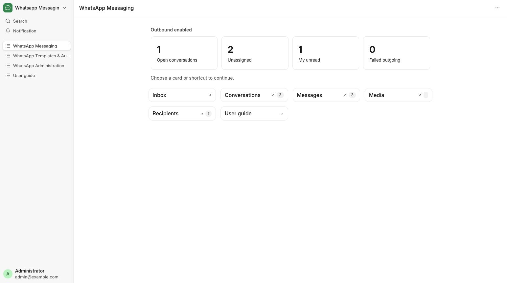

# Find your way around

Navigate hospital messaging, appointment reminders and follow-ups.

**Who can do this:** Editor · Admin · System Manager

## What this workflow does

This explains how the app is organized so you can find the tools you need. Messaging contains conversations and message history, Templates & Automation contains message rules and scheduled work, and Administration contains connection settings and troubleshooting tools.

[All workflows](README.md)

## 1. Sign in with your usual account

Use your existing Frappe login. A System Manager assigns Whatsapp Editor or Whatsapp Admin; a separate WhatsApp login is not needed.

## 2. Open WhatsApp Messaging

Select WhatsApp Messaging in Desk’s app chooser. Riverbend Hospital’s reception team uses Messaging for patient conversations and appointment updates.

## 3. Choose a workspace

Templates & Automation contains rules, approved templates, schedules and runs. Administration contains sender accounts and diagnostics and is visible to Admin and System Manager.

## 4. Use the cards and guide

Cards open the matching list or inbox filter. Open User guide from any workspace or the app sidebar; search by a task or a button name.

## What to check

You can open the workspaces allowed by your role. A fresh installation can correctly show zero records.

## If you need help

If the app is missing, refresh Desk and ask your System Manager to check installation and your existing roles. A disabled outbound banner means browsing is available but sends are blocked.

## Screenshots

Messaging workspace: inbox shortcuts, summary cards and User guide.

## Related workflows

- [Find or start a conversation](conversations.md)
- [Create and review a message template](templates.md)
- [Configure a sender and integration](senders.md)
- [Send documents automatically](document-delivery.md)

Screenshots show local development screens. Available fields, values, sender accounts and actions depend on your site configuration and permissions. Updated 30 October 2026.
