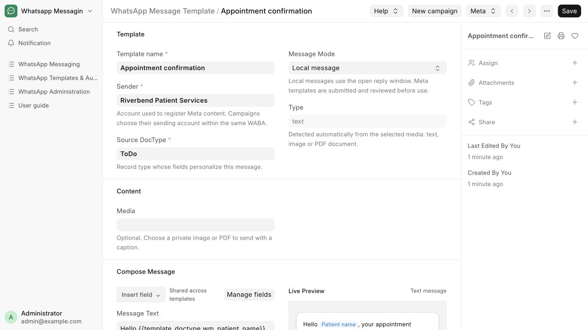
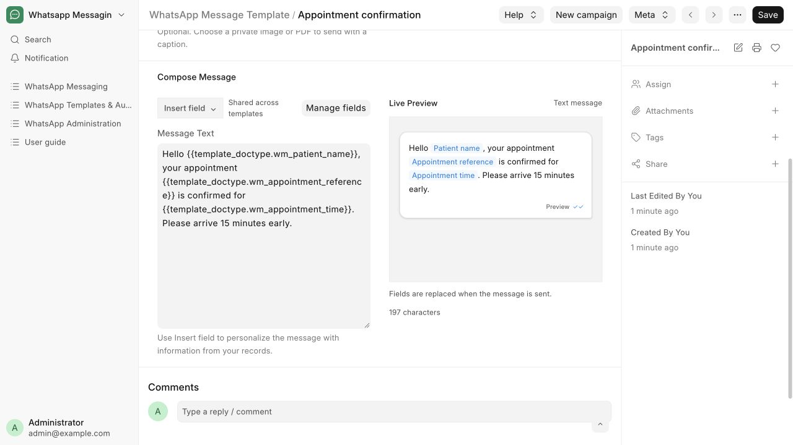
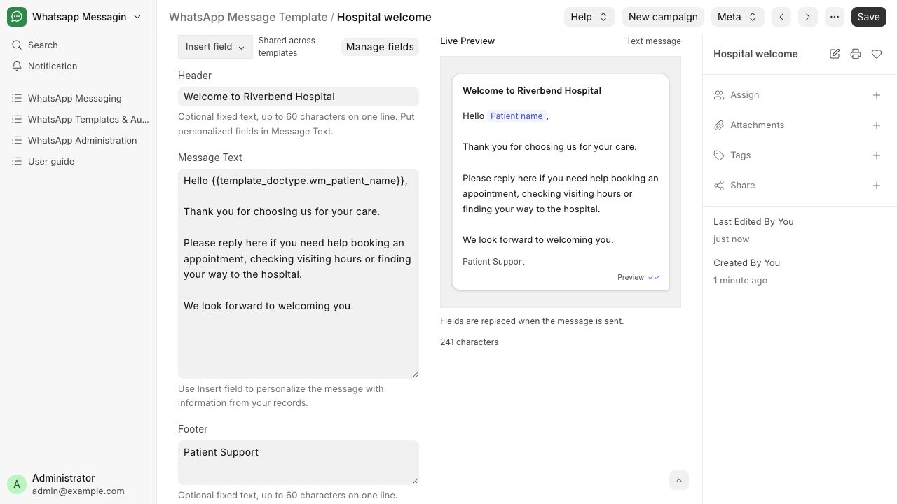
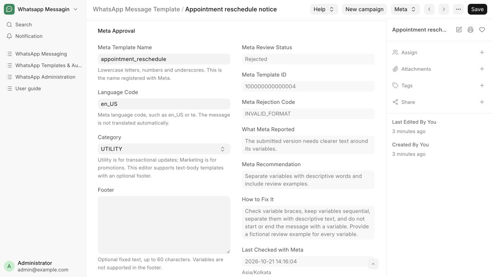
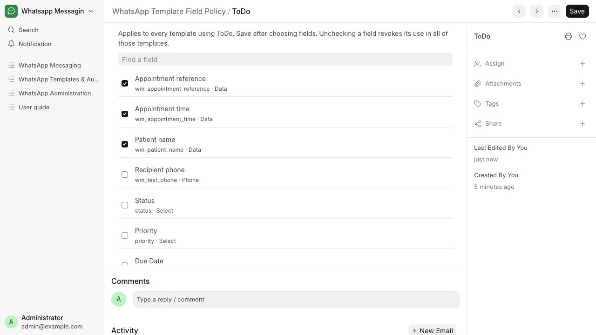
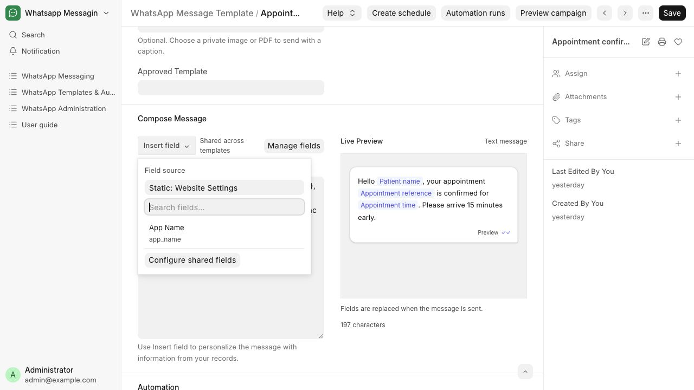
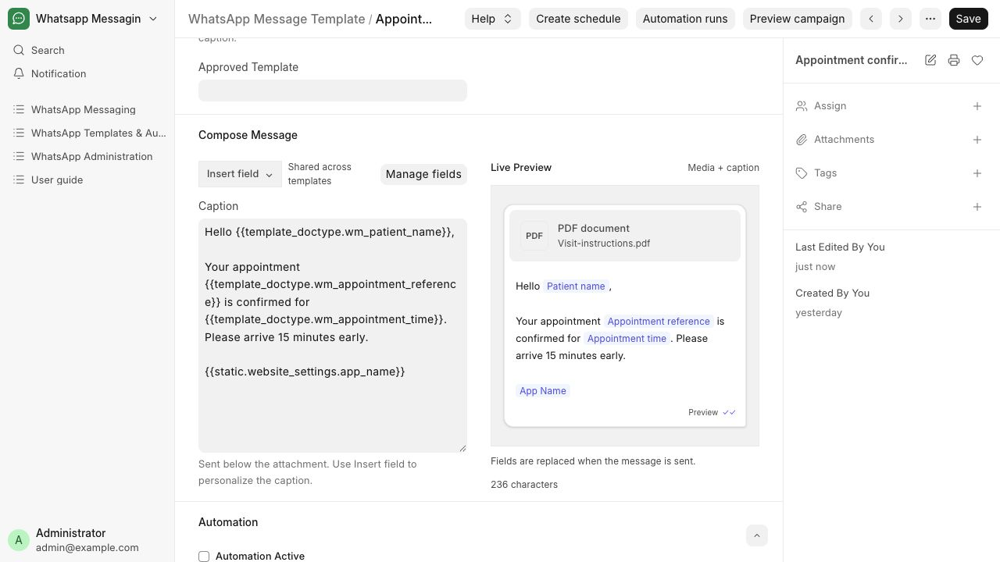

# Create and review a message template

Write reusable message content and manage its Meta review in one template.

**Who can do this:** Editor · Admin · System Manager

## What this workflow does

This defines the message itself: its text, optional media, reusable fields and Meta review details. Saving a draft does not submit it to Meta or send a message. Campaigns select this content and separately control recipients, sending times and automation.

[All workflows](README.md)

## 1. Create reusable content

Open Templates & Automation → Templates. Add Appointment confirmation, choose Riverbend Patient Services in Sender, and select the source DocType used for personalization. Select Local message for free-form content or Meta-approved template for wording that must be reviewed by Meta.

## 2. Import existing Meta content when needed

Open the Sender and choose Sync approved templates. Review the list, choose a Source DocType and import selected entries. Imports preserve Header, Message Text and Footer. Map every numbered variable using Variables & Review Examples before using the content in a campaign. Existing drafts are preserved; unsupported entries show an explanation.

## 3. Approve shared fields once

A System Manager selects allowed business fields in Template Field Policies. Insert field offers approved fields from the source DocType and readable Single DocTypes such as Hospital Settings. These choices apply to all templates using that source.

## 4. Write and preview the message

Write the message next to Live Preview and use Insert field for patient name and appointment reference. In Local message mode, selecting private media changes Message Text to Caption and shows the attachment above it. Remove Media to restore text mode. Header and Footer are optional fixed text fields, each up to 60 characters on one line. The preview shows them above and below the body. Put personalized fields in Message Text; header variables are not supported.

## 5. Prepare a Meta submission

In Meta mode, enter a lowercase Meta Template Name, language code and Utility or Marketing category. Provide a fictional review example for each variable. Imported numbered variables also need a Source Field mapping. Save, then an Admin chooses Meta → Submit to Meta. Saving alone makes no Meta request.

## 6. Read the review outcome

Check Meta status to refresh the account catalogue. Signed review webhooks can update the status too. If Rejected, read Meta’s reason and recommendation, then the app’s suggested fix. If Meta gives no detail, open WhatsApp Manager or Business Support Home rather than guessing the cause. Edit, save and choose Submit changes to Meta when ready.

## 7. Use the template in a campaign

Choose New campaign from a saved template. The campaign references this content and owns the sender, recipients, filters and sending workflow. Multiple campaigns can reuse the same template.

## What to check

The saved template contains the intended content. For Meta mode, its status applies to the exact submitted wording and sender account.

## If you need help

Editors, Admins and System Managers can edit content. Only Admins and System Managers can submit to Meta or refresh Meta status. Meta authoring supports a text body, positional variables, and optional fixed text header and footer. Media headers, header variables, buttons, authentication templates and named parameters are not supported in Meta mode. Local messages can use private JPEG/PNG/PDF media and require an open reply window. Changing approved wording requires another Meta submission. Saving content does not activate campaigns. If a submission times out, check status before retrying. After ten minutes and a complete check finding no match, another explicit submission is permitted; nothing is resent automatically.

## Screenshots

Reusable content: sender, source fields, message editor and Live Preview.

Message Text and inserted fields appear beside the live message preview.

A fictional hospital welcome draft uses separate Header, Message Text and Footer fields with a live preview.

Meta review shows the simulated rejection reason, Meta recommendation and separate suggested fix. This is fictional training data.

A System Manager approves shared message fields once for all templates using that source DocType.

Insert field includes readable Single DocTypes under Static sources.

Local media changes Message Text to Caption and shows the attachment in Live Preview.

## Related workflows

- [Manage reusable media files](media-library.md)
- [Send from a business record](record-send.md)
- [Activate a campaign for document events](events.md)
- [Create or pause a schedule](schedules.md)
- [Configure and run a campaign](campaigns.md)
- [Use an approved WhatsApp template](approved-templates.md)

Riverbend Hospital is a fictional training setting; no real patient data is shown. Updated 22 October 2026.
