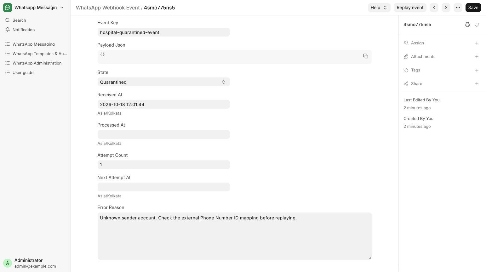

# Review inbound and webhook issues

Investigate incoming patient messages and delivery receipts.

**Who can do this:** Admin · System Manager

## What this workflow does

This handles incoming updates from WhatsApp, including received messages and delivery receipts. If an update cannot be processed, an Admin can inspect its state and error reason, correct the cause and request another processing attempt. These updates keep conversation history and delivery status current.

[All workflows](README.md)

## 1. Check inbound configuration

Ask your System Manager to confirm inbound capture, sender mapping, application secret and verification token. The callback is /api/method/whatsapp_messaging.messaging.webhooks.receive on the site’s reachable HTTPS domain.

## 2. Open Webhook events

In Administration open Webhook events and filter Failed or Quarantined. Check the sender mapping, event state and safe error reason. Raw payloads are restricted to System Manager.

## 3. Resolve the cause

Correct a missing account mapping or configuration issue before replaying. Do not repeatedly replay an unresolved event.

## 4. Replay and verify

For a Failed or Quarantined event, choose Replay event. Check its new state, then inspect the affected conversation or message receipt.

## What to check

Valid events create or update the appropriate message history. Duplicate provider events are handled once; late status receipts do not regress delivery.

## If you need help

Public HTTPS routing and Meta callback configuration must be set up separately by the System Manager. An event list alone does not prove a live callback is configured.

## Screenshots

Quarantined webhook event with its safe reason and Replay event action.

## Related workflows

- [Configure a sender and integration](senders.md)
- [Check delivery and handle blocked sends](delivery.md)

Riverbend Hospital is a fictional training setting; no real patient data is shown. Updated 24 October 2026.
